<p align="center">
  
</p>

<p align="center">
  <a href="https://github.com/maximkurein/DDS/actions/workflows/ci.yml"></a>
  <a href="https://github.com/maximkurein/DDS/releases/latest"></a>
  
  
  
  
  
</p>

<p align="center">
  <a href="#скачать"><strong>Скачать DDS Studio</strong></a>
  &nbsp;·&nbsp; <a href="#плата">Плата</a>
  &nbsp;·&nbsp; <a href="#прошивка">Прошивка</a>
  &nbsp;·&nbsp; <a href="#dds-studio">DDS Studio</a>
  &nbsp;·&nbsp; <a href="USER_GUIDE.md">Руководство</a>
  &nbsp;·&nbsp; <a href="README_RU.md">Инженерные подробности</a>
</p>

Синтезатор частоты **48–52 МГц** с шагом **1 кГц** и выходом **−10 дБм на 50 Ом**. Сигнал формирует прямой цифровой синтезатор **1508ПЛ8Т** (АО НПЦ «ЭЛВИС») от такта 480 МГц, управляет им контроллер **1887ВЕ7Т**. Частоту задают DIP-переключатели или компьютер через USB-UART и приложение **DDS Studio**.

В репозитории всё изделие: проект платы в KiCad с конструкторской документацией по ГОСТ ЕСКД, прошивка контроллера и настольное приложение для управления и изучения DDS.

<p align="center">
  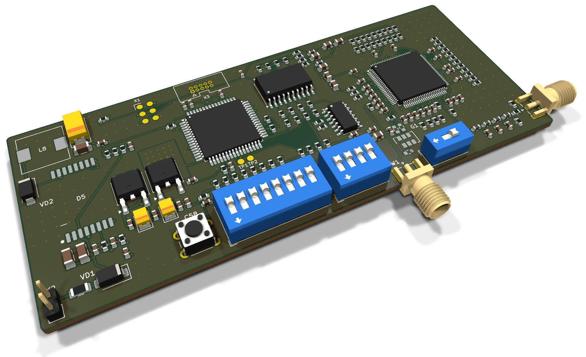
  <br><sub>Ревизия F, 120×50 мм, 4 слоя. Рендер KiCad 10 из <code>DDS_48_52.kicad_pcb</code>.</sub>
</p>

## Из чего состоит

| | Часть | Что внутри | Где |
|---|---|---|---|
| 🧩 | **Плата** | схема на 3 листах, плата 4 слоя, Gerber/BOM/CPL для JLCPCB, Э3 и ПЭ3 | [`DDS_48_52.kicad_pro`](DDS_48_52.kicad_pro), [`output/`](output) |
| ⚙️ | **Прошивка D2** | запуск 1508ПЛ8Т по SPI, частота с DIP, бесшовная смена, команды по UART | [`firmware/`](firmware) |
| 🖥️ | **DDS Studio** | регистры, расчёт частоты и спектра, виртуальная плата, опыты, уроки | [`studio/`](studio) |

## Скачать

**DDS Studio 0.3.0 для macOS и Windows** — на странице [релизов](https://github.com/maximkurein/DDS/releases/latest):

| Файл | Что это |
|---|---|
| `DDS-Studio-v0.3.0-macos-universal.dmg` | macOS (Apple Silicon и Intel): перетащите DDS Studio в «Программы» |
| `DDS-Studio-v0.3.0-macos-universal.app.zip` | то же приложение без образа диска |
| `DDS-Studio-v0.3.0-windows-x64.zip` | Windows 10/11: распакуйте и запустите `DDS Studio.exe`, установка не нужна |
| `checksum.txt` | контрольные суммы SHA-256 |

Приложение не подписано. Windows SmartScreen: «Подробнее» → «Выполнить в любом случае». macOS при первом запуске: правый клик по приложению → «Открыть», или

```bash
xattr -dr com.apple.quarantine "/Applications/DDS Studio.app"
```

Без платы приложение работает с **виртуальной платой**: все экраны и опыты доступны сразу. Windows и веб-режим собираются из исходников — см. [studio/BUILD.md](studio/BUILD.md).

## Плата

| Узел | Что |
|---|---|
| DDS | 1508ПЛ8Т (D1): 48-битный аккумулятор фазы, 10-битный ЦАП, такт 480 МГц |
| Контроллер | 1887ВЕ7Т (D2), +5 В, тактирование от внутреннего RC 8 МГц |
| Выход | ФНЧ 7-го порядка (срез ≈ 70 МГц) и аттенюатор → XW2, −10 дБм на 50 Ом |
| Такт | S1: внешний вход XW1 или генератор G1 (не устанавливается) |
| Частота | DIP S2 (8 разрядов) + S3 (4 разряда), кнопка «Применить» S4 |
| Связь с ПК | USB-UART на площадках X1, 38400 8N1, логика 5 В |
| Питание | +15 В → DC/DC 1393ЕУ014 (+5 В) → LDO 1158ЕН3.3ВХ (+3,3 В), 1325ЕН1.8У (+1,8 В) |
| Конструкция | 120×50 мм, 4 слоя, JLC04161H-7628, ENIG |

<table>
  <tr>
    <td width="50%">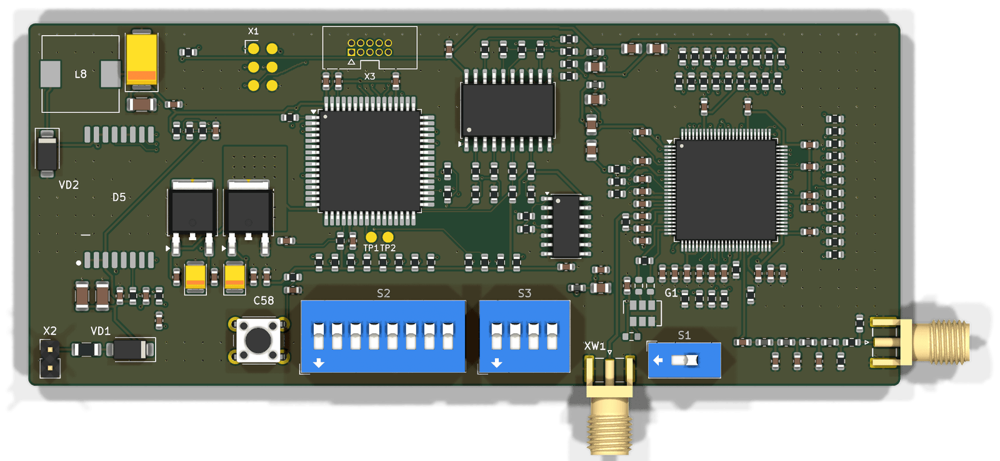<br><sub><b>Сверху.</b> D1 — справа, D2 — в центре, DIP S2/S3 и кнопка S4 внизу, SMA XW1 (такт) и XW2 (выход).</sub></td>
    <td width="50%">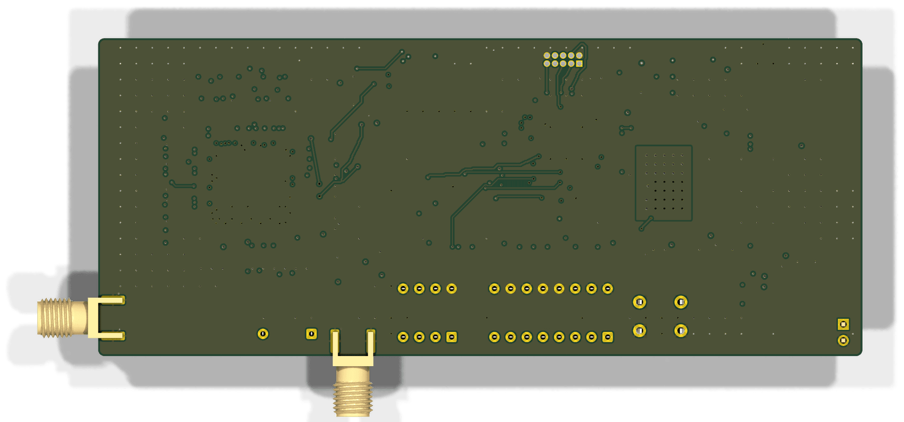<br><sub><b>Снизу.</b> Элементов нет: полигон земли, сшивка переходными отверстиями по краям, выводы DIP и SMA.</sub></td>
  </tr>
</table>

**Статус.** ERC 0, DRC со сверкой со схемой 0, соединения совпадают с эталоном ревизии F. Это **ещё не выпуск в производство**: посадочные места новых отечественных элементов — заполнители до получения чертежей корпусов, генератор G1 не подтверждён паспортом, нагрев 1325ЕН1.8У и устойчивость 1393ЕУ014 нужно проверить. Подробно — [README_RU.md](README_RU.md), [docs/REVISION_F.md](docs/REVISION_F.md), [docs/design_notes.md](docs/design_notes.md).

Схема и плата открываются в KiCad 10: `DDS_48_52.kicad_pro`. PDF схемы и сборочного чертежа — в [`output/pdf/`](output/pdf), файлы для заказа — в [`output/jlcpcb/`](output/jlcpcb).

## Прошивка

Прошивка контроллера D2 написана на C (avr-gcc, CMake), собирается и прошивается из VS Code/Cursor через JTAG (X3).

- После включения ждёт питание DDS, сбрасывает и настраивает 1508ПЛ8Т, ставит частоту с DIP-переключателей.
- Новая частота включается кнопкой S4 **без разрыва фазы**: запись в неактивный профиль и переключение `SEL_REG`.
- С версии **1.1.0** принимает команды по UART (`?`, `REMOTE`, `W`, `R`, `S`, `RST`, `HOP`, `ST`): в режиме `REMOTE` частотой управляет компьютер.
- Логика проверяется на ПК host-тестами с подменой SPI и таймеров (`cmake --preset host-tests`).

Подробно — [firmware/README.md](firmware/README.md), первая прошивка платы — [USER_GUIDE.md](USER_GUIDE.md).

## DDS Studio

Настольное приложение для управления платой и изучения DDS: ядро на Rust, нативный интерфейс на egui (без WebView) для macOS и Windows, плюс веб-режим на React. Интерфейс на русском.

<p align="center">
  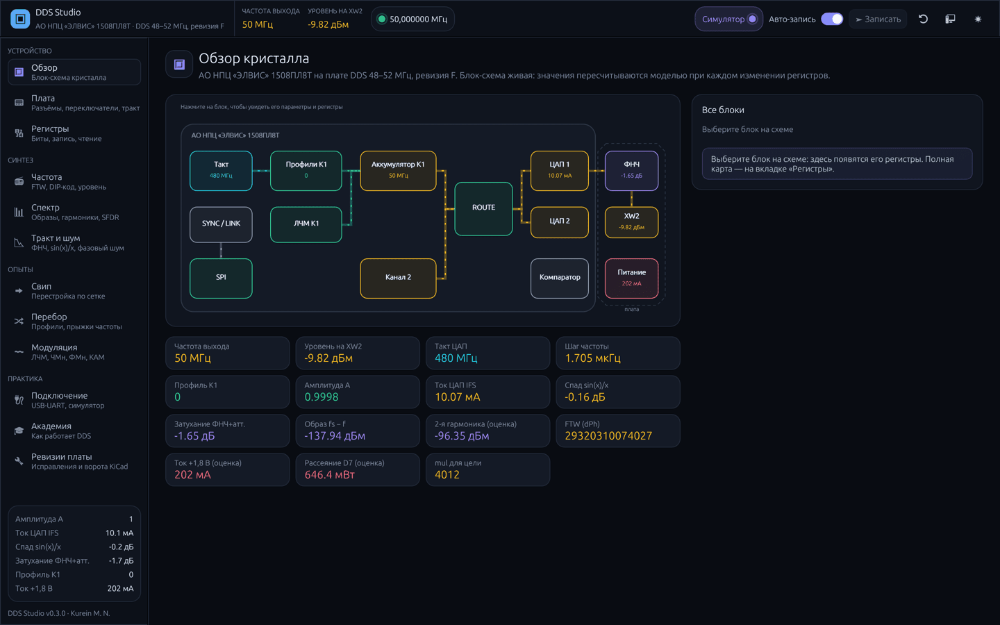
  <br><sub>Живая блок-схема 1508ПЛ8Т: нажмите на блок — справа его параметры и поля регистров. Снимки — DDS Studio 0.3.0 (egui).</sub>
</p>

<table>
  <tr>
    <td width="50%">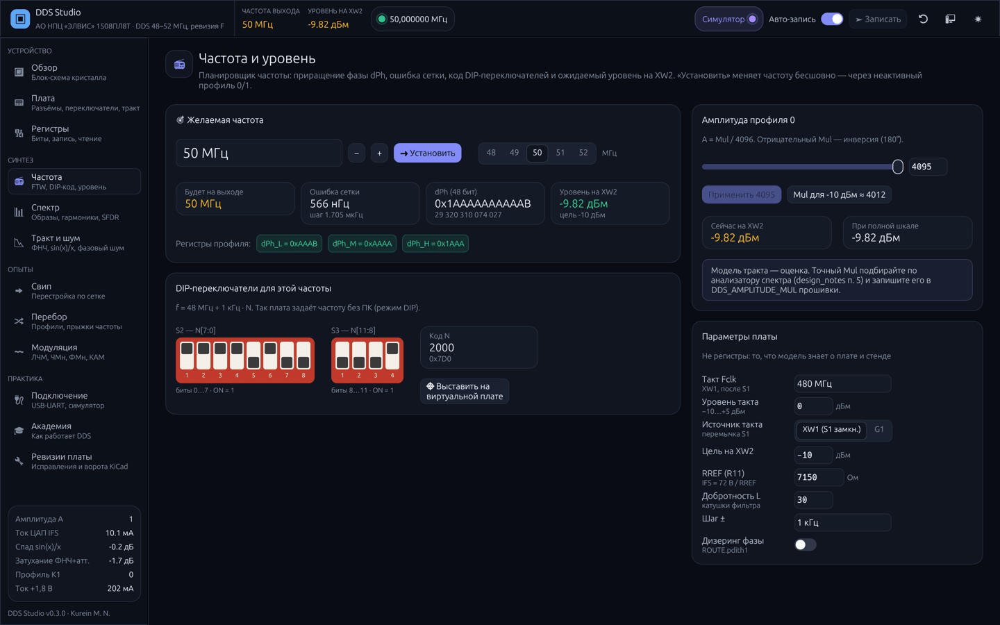<br><sub><b>Частота.</b> Приращение фазы dPh, ошибка сетки, DIP-код, ожидаемый уровень на XW2 и подбор амплитуды.</sub></td>
    <td width="50%">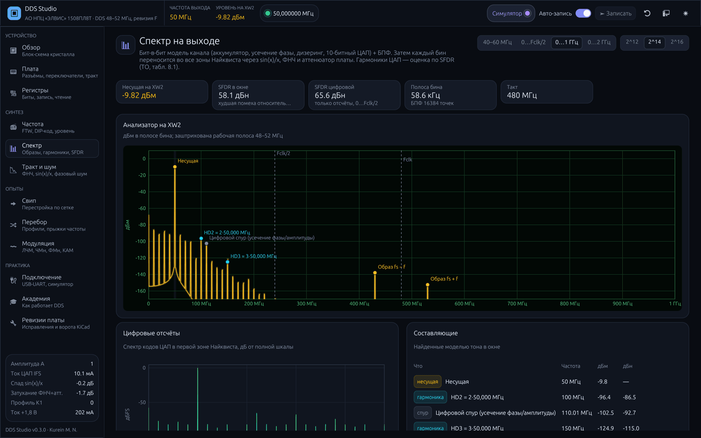<br><sub><b>Спектр.</b> Бит-в-бит модель канала и БПФ: несущая, гармоники, образы Fclk ± f, спуры усечения фазы.</sub></td>
  </tr>
  <tr>
    <td>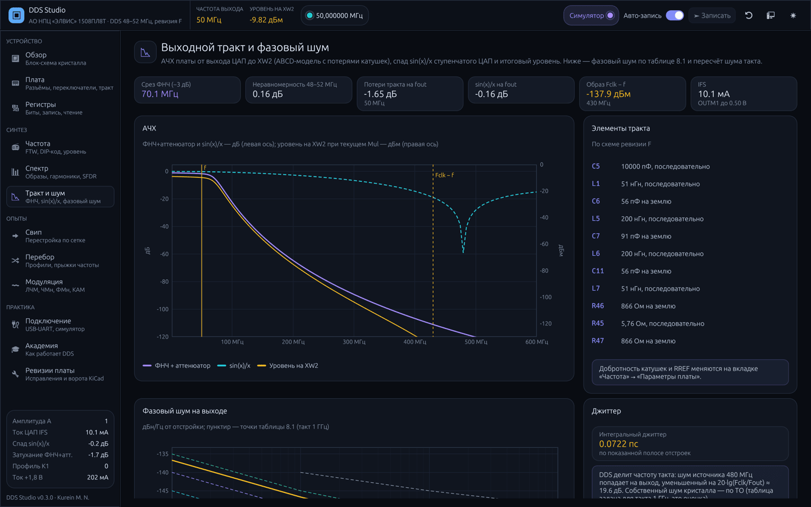<br><sub><b>Тракт и шум.</b> АЧХ ФНЧ и аттенюатора с потерями катушек, sin(x)/x, фазовый шум и джиттер.</sub></td>
    <td>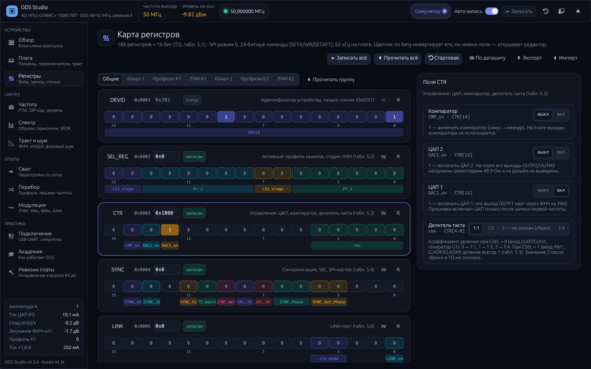<br><sub><b>Регистры.</b> 186 регистров по ТО, поля по битам, запись и чтение, экспорт в C-массив для прошивки.</sub></td>
  </tr>
  <tr>
    <td>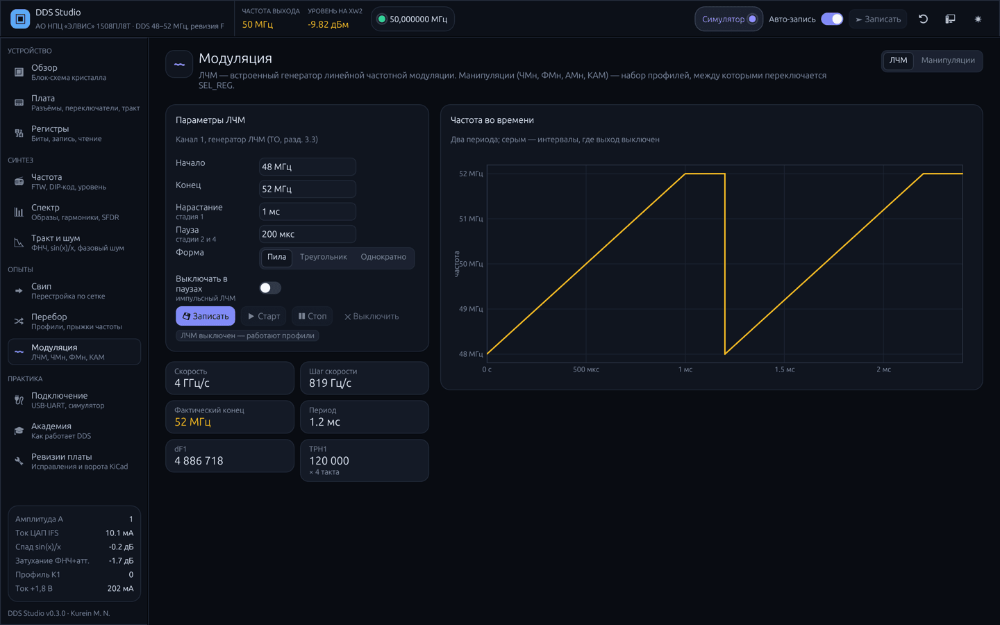<br><sub><b>ЛЧМ.</b> Встроенный генератор линейной частотной модуляции: пила, треугольник, импульсный режим.</sub></td>
    <td>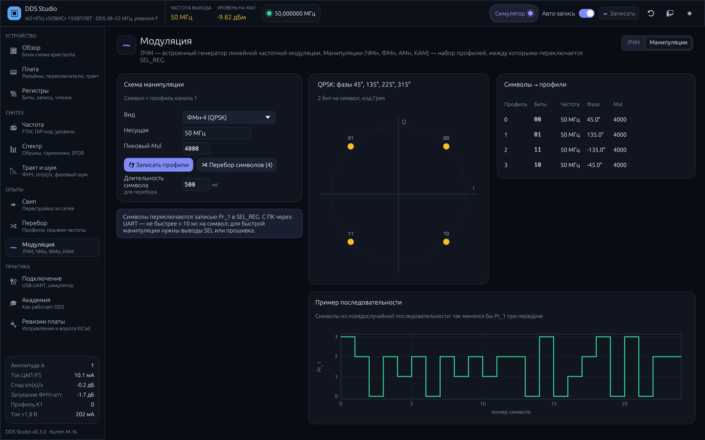<br><sub><b>Манипуляции.</b> ЧМн, ФМн-2/4/8, АМн, КАМ-16 на профилях с созвездием и последовательностью символов.</sub></td>
  </tr>
  <tr>
    <td>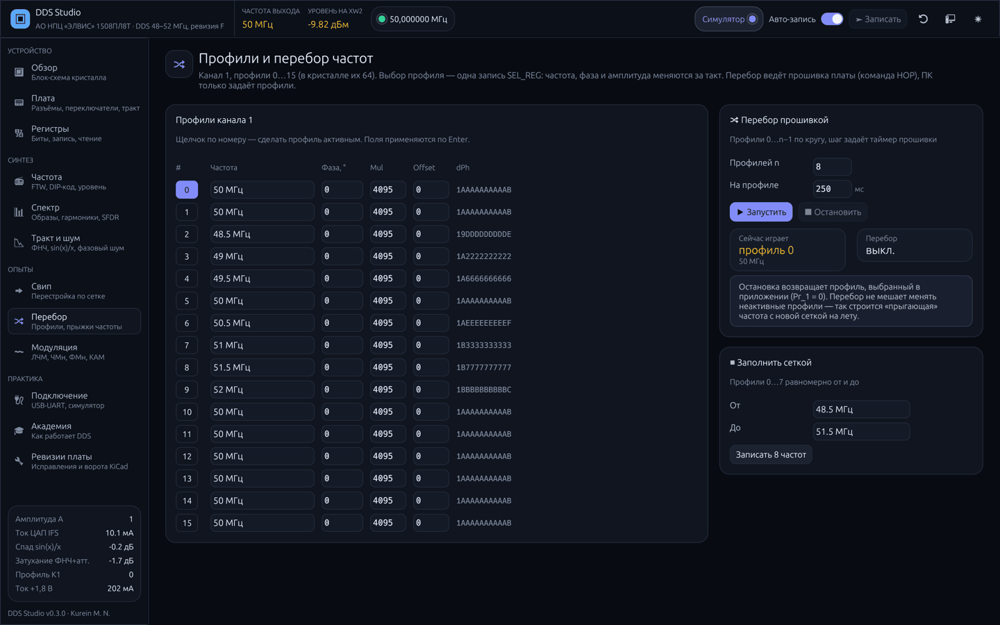<br><sub><b>Перебор.</b> 16 профилей канала 1; прошивка переключает их по таймеру (<code>HOP</code>).</sub></td>
    <td>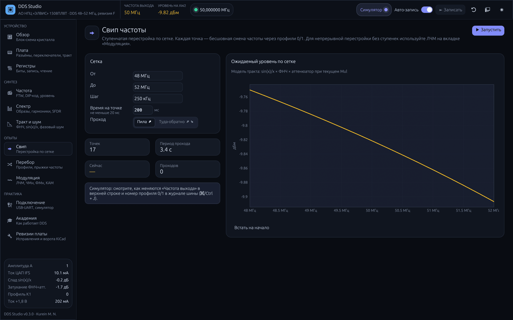<br><sub><b>Свип.</b> Ступенчатая перестройка 48 → 52 МГц с бесшовной сменой частоты на каждой точке.</sub></td>
  </tr>
  <tr>
    <td>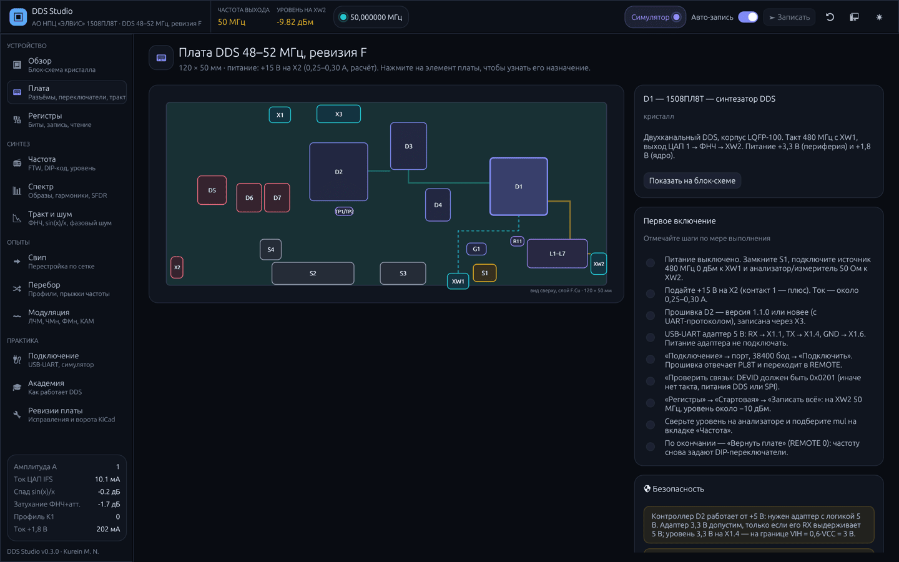<br><sub><b>Плата.</b> Вид по файлу KiCad, назначение каждого элемента, чек-лист первого включения.</sub></td>
    <td>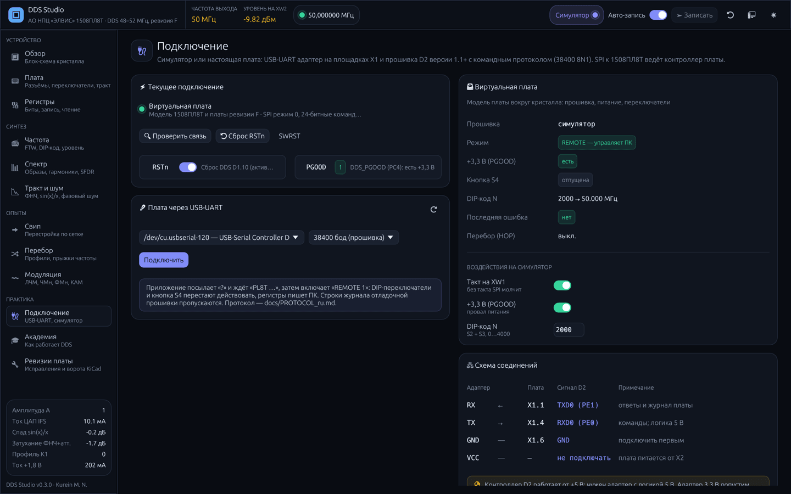<br><sub><b>Подключение.</b> USB-UART, состояние платы (REMOTE, PGOOD, DIP), схема проводов и предупреждения.</sub></td>
  </tr>
  <tr>
    <td>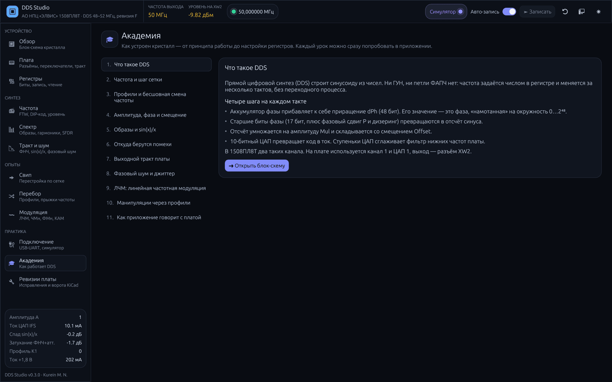<br><sub><b>Академия.</b> 11 уроков от принципа DDS до протокола платы, из каждого — переход к опыту.</sub></td>
    <td>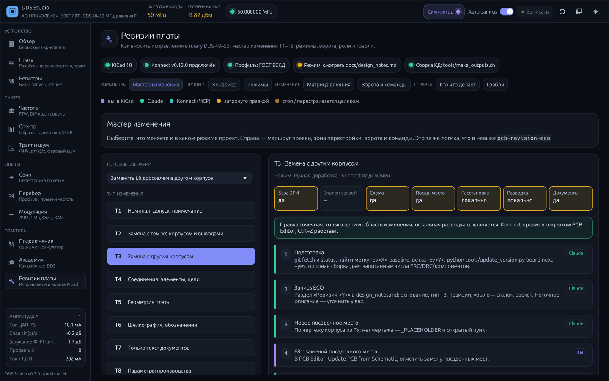<br><sub><b>Ревизии платы.</b> Как исправить плату в KiCad: мастер изменения T1–T8, матрица влияния, ворота ERC/DRC с командами.</sub></td>
  </tr>
  <tr>
    <td colspan="2">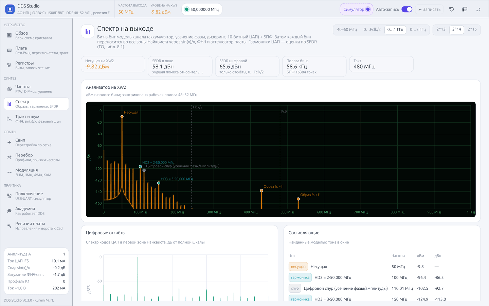<br><sub><b>Светлая тема.</b> Переключается одной кнопкой в верхней панели.</sub></td>
  </tr>
</table>

Подробно о приложении — [studio/README.md](studio/README.md): подключение к плате, протокол, архитектура, сборка.

### Подключение к плате

<p align="center">
  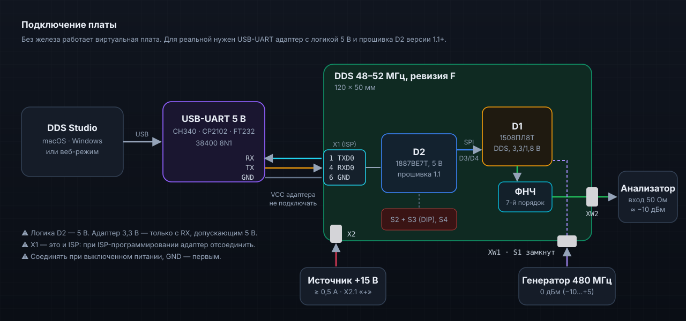
</p>

| USB-UART адаптер | Плата | Сигнал D2 |
|---|---|---|
| RX | X1.1 | TXD0 (PE1) |
| TX | X1.4 | RXD0 (PE0) |
| GND | X1.6 | GND |

> [!WARNING]
> D2 работает от **+5 В** — нужен адаптер с логикой 5 В. Питание адаптера к плате **не подключать**. X1 — это и площадки ISP: на время ISP-программирования адаптер отсоединить. Такт на XW1 — от −10 до +5 дБм.

## Структура репозитория

```
DDS_48_52.kicad_pro, *.kicad_sch, *.kicad_pcb   проект KiCad (ревизия F)
lib/                                            символы, посадочные места, рамка ГОСТ
output/                                         PDF, BOM, нетлист, Gerber/CPL JLCPCB, Э3 (Visio), ПЭ3 (Word)
firmware/                                       прошивка D2 (1887ВЕ7Т), host-тесты
studio/                                         DDS Studio: Rust (egui) + веб-режим React
docs/                                           инженерные примечания, ревизии, уроки
tools/                                          генераторы схемы и платы, выпуск документов
.claude/skills/                                 скиллы Claude Code: разработка и ревизии плат
```

## Документация

| Документ | О чём |
|---|---|
| [START_HERE.md](START_HERE.md) | первый шаг на новой машине: клонирование, окружение, правила работы |
| [USER_GUIDE.md](USER_GUIDE.md) | руководство пользователя: подключение, частота, первая прошивка |
| [README_RU.md](README_RU.md) | плата подробно: листы схемы, пересборка, скрипты, история ревизий |
| [firmware/README.md](firmware/README.md) | прошивка: сборка, отладка, протокол UART (раздел 8.5) |
| [studio/README.md](studio/README.md) | DDS Studio: возможности, подключение, сборка |
| [studio/docs/PROTOCOL_ru.md](studio/docs/PROTOCOL_ru.md) | команды прошивки по UART |
| [docs/REVISION_F.md](docs/REVISION_F.md) | изменения ревизии F и состав КД |

Первоисточник по кристаллу — [ТО 1508ПЛ8Т](https://elvees.ru/typo11/mc/data_sheets/Manual_1508PL8T.pdf) (АО НПЦ «ЭЛВИС», ред. 14.10.2020). PDF производителей в репозиторий не кладём.

## Скиллы Claude Code

Технология «ТЗ → ЭРИ → схема → плата → документы → производство» и выпуск ревизий записаны как скиллы Claude Code в `.claude/skills/` и подхватываются при запуске Claude Code из корня репозитория:

- `pcb-design-pipeline` — сквозная разработка платы (KiCad, ГОСТ ЕСКД, JLCPCB);
- `pcb-revision-eco` — исправления и новая ревизия готовой платы.

Уроки проекта — в [docs/lessons.md](docs/lessons.md).

## Что ещё не проверено

- Плата ревизии F не изготовлена: работа на железе, уровень −10 дБм и тепловой режим не подтверждены.
- Прошивка 1.1.0 проверена host-тестами на ПК; сборка avr-gcc и UART на плате ещё не проверялись.
- Модель DDS Studio — инженерное приближение по ТО и схеме; уровень на XW2 уточняется измерением.

<details>
<summary><b>English summary</b></summary>

Frequency synthesizer 48–52 MHz, 1 kHz step, −10 dBm into 50 Ω, built around the 1508PL8T DDS (Elvees) clocked at 480 MHz and the 1887VE7T controller; board revision F, 120×50 mm, 4 layers, KiCad 10 with GOST ESKD documents and JLCPCB outputs. The repository also holds the controller firmware (C, CMake; UART command protocol since 1.1.0) and **DDS Studio**, a native Rust/egui desktop app (macOS, Windows) with a React web mode with a register map, frequency planner, bit-exact spectrum model, output-filter and phase-noise models, chirp and keying experiments, a virtual board and Russian lessons. Not a production release: new domestic parts still use placeholder land patterns and the board has not been built yet. The repository is mirrored on GitHub and a private Forgejo.

</details>
