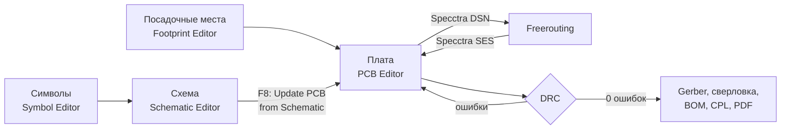
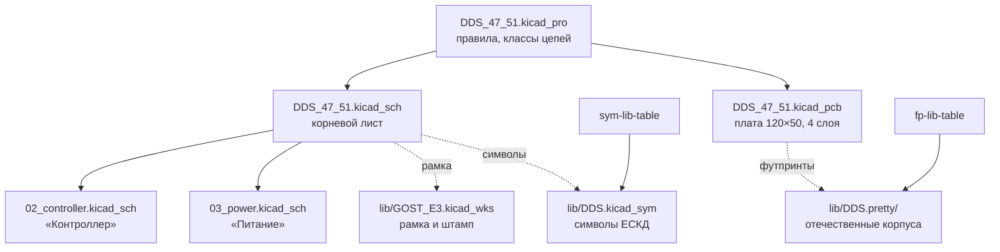
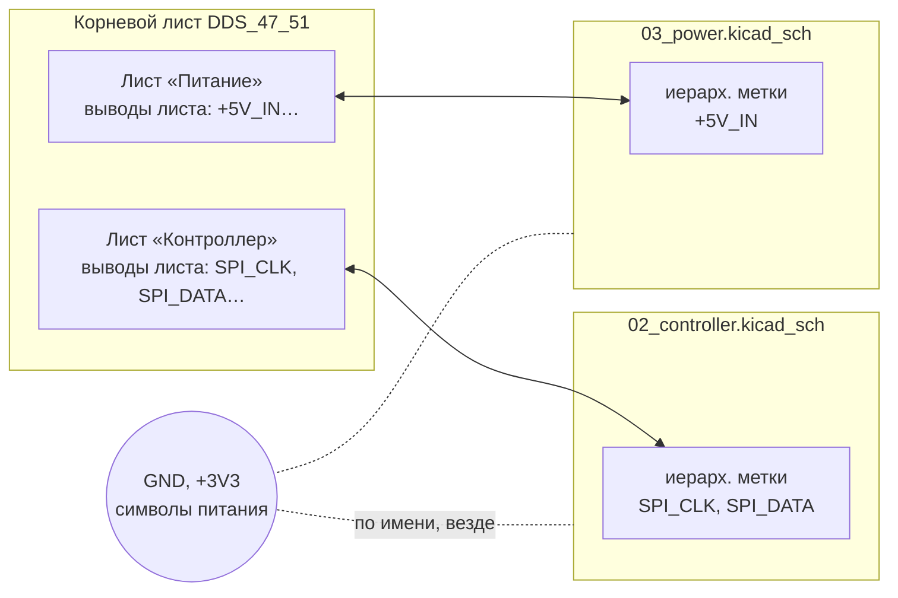
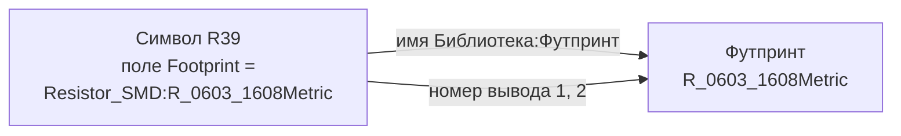
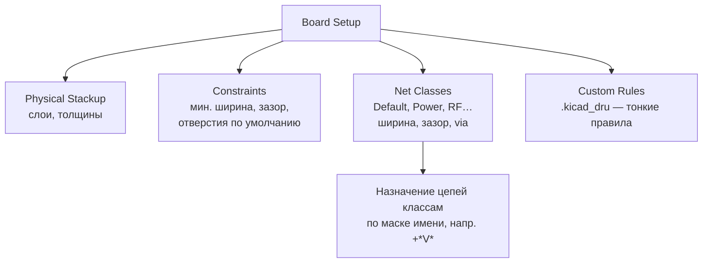
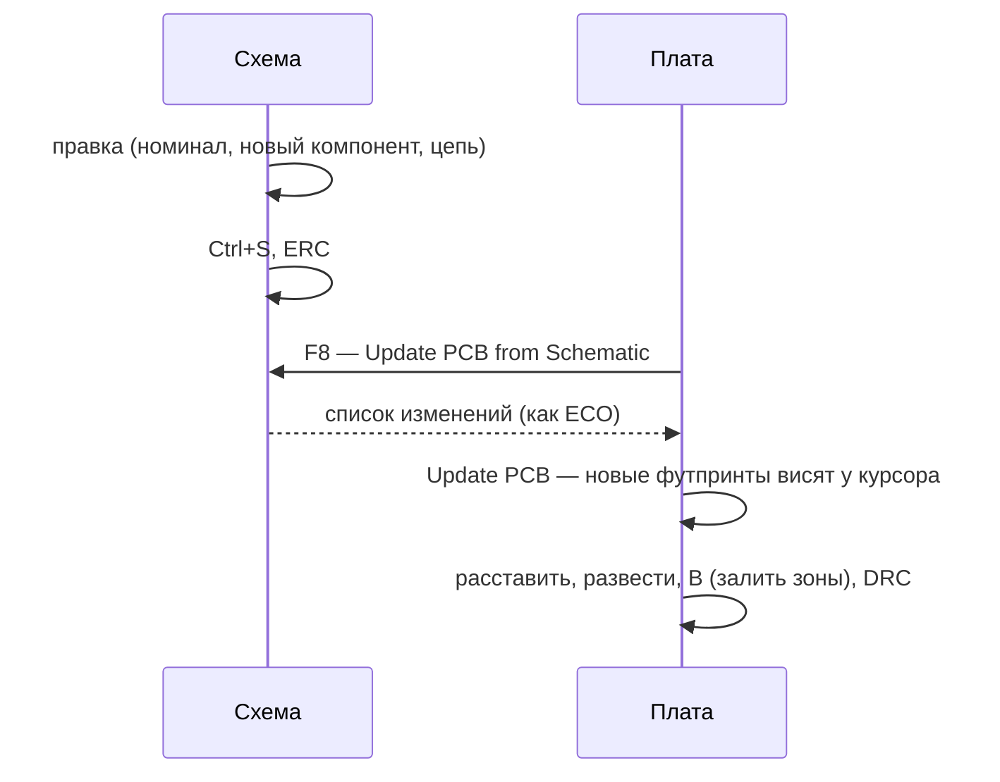
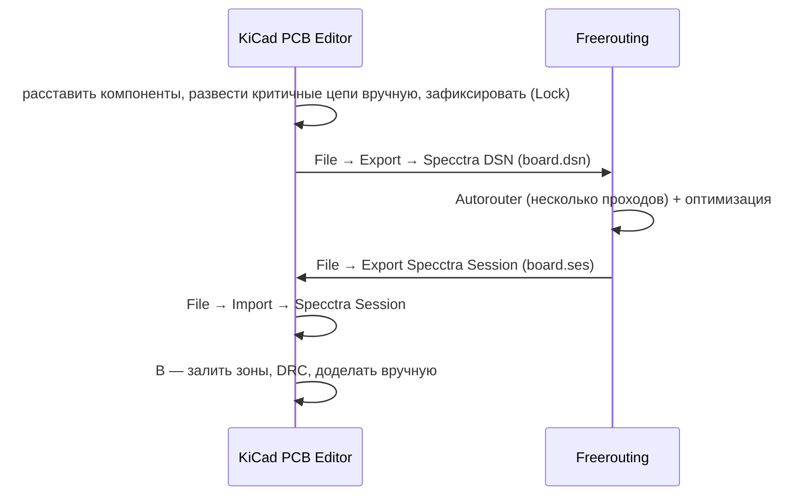
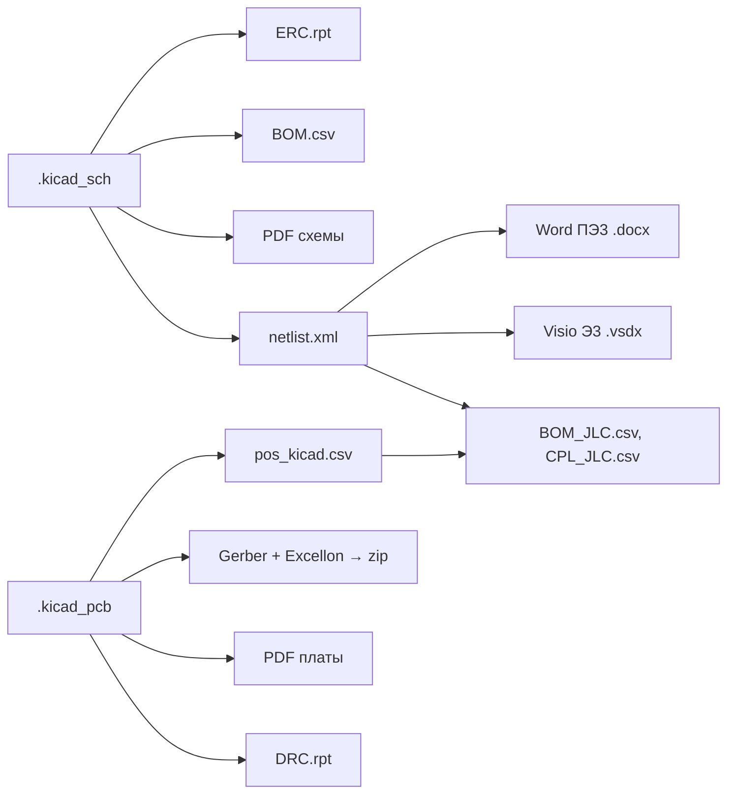
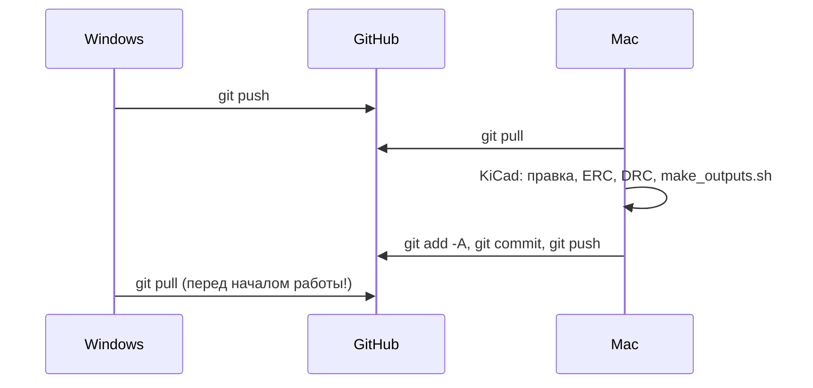

# KiCad 10 для инженера с опытом P-CAD и Specctra

Практический курс на примере проекта **DDS** (`~/Project/DDS`): схема из трёх листов, 4-слойная плата 120×50 мм, своя ГОСТ-библиотека, выпуск на JLCPCB.

> На Mac везде вместо **Ctrl** нажимайте **Cmd**, вместо **Alt** — **Option**.
> Полный список горячих клавиш в любом редакторе: **Ctrl+F1** (Help → List Hotkeys). Если клавиша из уроков не сработала — сверьтесь с ним.
> Диаграммы ниже написаны на Mermaid: их показывают GitHub, VS Code (с расширением Markdown Preview Mermaid), Obsidian, Typora.

---

## Содержание

0. [Подготовка](#0-подготовка)
1. [Словарь P-CAD → KiCad](#1-словарь-p-cad--kicad)
2. [Урок 1. Проект и библиотеки](#урок-1-проект-и-библиотеки)
3. [Урок 2. Схема](#урок-2-схема)
4. [Урок 3. Символы и посадочные места](#урок-3-символы-и-посадочные-места)
5. [Урок 4. Плата](#урок-4-плата)
6. [Урок 5. Автотрассировка, DRC, выходные файлы](#урок-5-автотрассировка-drc-выходные-файлы)
7. [Урок 6. kicad-cli, скрипты DDS и git](#урок-6-kicad-cli-скрипты-dds-и-git)
8. [Типичные проблемы](#типичные-проблемы)
9. [Шпаргалка](#шпаргалка)
10. [Где учиться дальше](#где-учиться-дальше)

---

## 0. Подготовка

### Общая картина: та же цепочка, что в P-CAD



Отличия от P-CAD коротко:

- **Нет отдельной операции «нетлист»** — схема и плата синхронизируются кнопкой (F8) в обе стороны.
- **Нет «компонента» как третьей сущности** — у символа есть поле `Footprint`, в нём имя посадочного места.
- **Все файлы текстовые** (S-выражения) — их хорошо видно в `git diff`.
- **Автотрассировщик внешний** — Freerouting, формат тот же, что у Specctra.
- **Всё доступно из командной строки** (`kicad-cli`) и из Python (модуль `pcbnew`).

### Рабочая ветка для обучения

Чтобы не испортить рабочий проект, практикуйтесь в отдельной ветке:

```sh
cd ~/Project/DDS
git pull
git switch -c learn        # своя ветка для экспериментов
```

Что-то сломали — `git restore .` возвращает файлы к последнему коммиту. Закончили — `git switch main && git branch -D learn`.

### Чек-лист установки (Mac)

- [ ] KiCad 10.0.x в `/Applications/KiCad/KiCad.app` (`brew install --cask kicad`)
- [ ] При первом запуске выбрана **копия глобальной таблицы библиотек по умолчанию**
- [ ] Python-пакеты в Python KiCad:
  ```sh
  /Applications/KiCad/KiCad.app/Contents/Frameworks/Python.framework/Versions/Current/bin/python3 \
      -m pip install shapely vsdx python-docx pillow
  ```
- [ ] `sh tools/make_outputs.sh .` даёт `Found 0 DRC violations`

---

## 1. Словарь P-CAD → KiCad

| P-CAD / Specctra | KiCad 10 | Файл / где | Заметка |
|---|---|---|---|
| P-CAD Schematic | **Schematic Editor** (Eeschema) | `.kicad_sch` | один файл на лист |
| P-CAD PCB | **PCB Editor** (Pcbnew) | `.kicad_pcb` | |
| — (проекта не было) | **Проект** | `.kicad_pro` | связывает схему, плату, правила |
| Library Executive | **Таблицы библиотек** | `sym-lib-table`, `fp-lib-table` | Preferences → Manage … Libraries |
| Symbol | **Symbol** | `.kicad_sym` (вся библиотека в одном файле) | |
| Pattern | **Footprint** (посадочное место) | папка `.pretty`, внутри по файлу `.kicad_mod` | |
| Component | Символ + поле `Footprint` | — | Tools → Assign Footprints |
| Gate (секция) | **Unit** (A, B, C…) | в символе | |
| Pad Stack | Свойства площадки | в футпринте | отдельной библиотеки стеков нет |
| RefDes, Value | **Reference**, **Value** | поля символа | + любые свои поля |
| Attributes | **Fields** (поля) | поля символа | в DDS: Допуск, Мощность, ТКЕ… |
| Generate/Load Netlist | **Update PCB from Schematic** | F8 | |
| Back Annotate | **Update Schematic from PCB** | в редакторе платы | |
| ECO | список изменений в окне F8 | | |
| Design Rules | **Board Setup** → Constraints, Net Classes | `.kicad_pro` | |
| — | **Custom Rules** (свой язык правил) | `.kicad_dru` | |
| Net Class | **Net Class** | Board Setup | |
| Copper Pour / Plane | **Zone** | на нужном слое | заливка — **B** |
| Keepout | **Rule Area** | | |
| Title Block | **Drawing Sheet** | `.kicad_wks` | в DDS: `lib/GOST_E3.kicad_wks` |
| Specctra `.dsn` / `.ses` | то же | File → Export / Import | трассировщик Freerouting |
| Gerber, NC Drill | **Fabrication Outputs** | File → Fabrication Outputs | или `kicad-cli` |
| Pick & Place | **Component Placement** (`.pos`) | Fabrication Outputs | |
| DRC | **DRC** | Inspect → Design Rules Checker | |
| ERC | **ERC** | Inspect → Electrical Rules Checker | |

---

## Урок 1. Проект и библиотеки

**Цель:** понять, из чего состоит проект и откуда KiCad берёт символы и посадочные места.
**Время:** ~1 час.

### 1.1 Менеджер проектов

Это главное окно KiCad. Открывайте схему и плату **только через него** (File → Open Project → `DDS_47_51.kicad_pro`). Если открыть `.kicad_sch` напрямую, проектные библиотеки и правила могут не подхватиться.

```
┌───────────────────────────── KiCad ─────────────────────────────┐
│ Файлы проекта            │  Редакторы                            │
│ ─────────────            │  ┌──────────────┐ ┌──────────────┐   │
│ ▾ DDS_47_51.kicad_pro    │  │ Schematic    │ │ Symbol       │   │
│   DDS_47_51.kicad_sch    │  │ Editor       │ │ Editor       │   │
│   DDS_47_51.kicad_pcb    │  └──────────────┘ └──────────────┘   │
│   02_controller.kicad_sch│  ┌──────────────┐ ┌──────────────┐   │
│   03_power.kicad_sch     │  │ PCB          │ │ Footprint    │   │
│ ▸ lib/                   │  │ Editor       │ │ Editor       │   │
│ ▸ output/                │  └──────────────┘ └──────────────┘   │
│ ▸ tools/                 │  Gerber Viewer · Calculator · …      │
└──────────────────────────┴───────────────────────────────────────┘
```

### 1.2 Файлы DDS



| Файл / папка | Что внутри | В git |
|---|---|---|
| `DDS_47_51.kicad_pro` | проект: правила, классы цепей, настройки | да |
| `DDS_47_51.kicad_sch` | корневой лист | да |
| `02_controller.kicad_sch`, `03_power.kicad_sch` | дочерние листы | да |
| `DDS_47_51.kicad_pcb` | плата | да |
| `lib/DDS.kicad_sym` | символы проекта | да |
| `lib/DDS.pretty/` | посадочные места проекта | да |
| `lib/GOST_E3.kicad_wks` | рамка по ГОСТ | да |
| `sym-lib-table`, `fp-lib-table` | подключение библиотеки DDS | да |
| `*.kicad_prl` | положение окон, видимые слои (личное) | **нет** |
| `*-backups/`, `*.lck` | автосохранения, блокировки | **нет** |

### 1.3 Два уровня библиотек

```
Глобальные таблицы  (~/Library/Preferences/kicad/10.0/)
│   Resistor_SMD, Capacitor_SMD, Package_QFP, … — стандартные, одни на все проекты
│
└── Проектные таблицы (рядом с .kicad_pro)
        DDS → ${KIPRJMOD}/lib/DDS.kicad_sym
        DDS → ${KIPRJMOD}/lib/DDS.pretty
```

`${KIPRJMOD}` — переменная «папка текущего проекта». Поэтому пути одинаково работают на Mac и Windows.

> Если в DRC/ERC появились сотни сообщений «The current configuration does not include the footprint library 'Resistor_SMD'» — пуста **глобальная** таблица. Лечится: Preferences → Manage Footprint Libraries → предложение импортировать таблицу по умолчанию, или:
> ```sh
> D=~/Library/Preferences/kicad/10.0; mkdir -p $D
> cp -n /Applications/KiCad/KiCad.app/Contents/SharedSupport/template/{fp,sym}-lib-table $D/
> ```

### 1.4 Практика

- [ ] Открыть `DDS_47_51.kicad_pro` через File → Open Project
- [ ] Preferences → Manage Symbol Libraries: на вкладке **Global** — стандартные, на вкладке **Project** — `DDS`
- [ ] То же в Manage Footprint Libraries
- [ ] Preferences → Configure Paths: посмотреть, куда указывают `KICAD10_SYMBOL_DIR`, `KICAD10_FOOTPRINT_DIR`
- [ ] Открыть `fp-lib-table` в текстовом редакторе — убедиться, что это обычный текст

---

## Урок 2. Схема

**Цель:** ходить по иерархической схеме, менять номиналы, добавлять компоненты и цепи, запускать ERC.
**Время:** 1,5–2 часа.

### 2.1 Окно редактора схем

```
┌──────────────────────────────────────────────────────────────────────┐
│ Меню · верхняя панель (сохранить, ERC, F8, BOM…)                      │
├────────────┬────────────────────────────────────────────┬────────────┤
│ Hierarchy  │                                            │ Инструменты│
│ ▾ /        │            Рабочее поле листа               │ (символ,   │
│   Контрол. │                                            │  провод,   │
│   Питание  │                                            │  метка,    │
│────────────│                                            │  лист…)    │
│ Properties │                                            │            │
│ (свойства  │                                            │            │
│  выбран.)  │                                            │            │
├────────────┴────────────────────────────────────────────┴────────────┤
│ Строка состояния: X/Y курсора, dx/dy, сетка, масштаб                   │
└──────────────────────────────────────────────────────────────────────┘
```

Если панелей Hierarchy или Properties нет — View → Panels.

### 2.2 Навигация

| Действие | Как |
|---|---|
| Масштаб | колесо мыши / щипок на тачпаде |
| Сдвиг | средняя кнопка или два пальца на тачпаде |
| Весь лист | **Home** |
| В дочерний лист | двойной щелчок по рамке листа или по имени в Hierarchy |
| На уровень вверх | кнопка «Leave sheet» на панели / щелчок по `/` в Hierarchy |
| Найти компонент | **Ctrl+F** (по Reference, Value, тексту) |

### 2.3 Горячие клавиши схемы

Клавиши действуют на объект **под курсором** — выделять заранее не нужно.

| Клавиша | Действие | Аналог в P-CAD |
|---|---|---|
| **A** | добавить символ | Place Part |
| **P** | символ питания (GND, +3V3…) | Place Power |
| **W** | провод | Place Wire |
| **B** | шина | Place Bus |
| **L** | локальная метка цепи | Net Label |
| **Ctrl+L** | глобальная метка | Port (глобальный) |
| **H** | иерархическая метка | Port на листе |
| **S** | иерархический лист | Sheet |
| **Q** | «не подключено» (крестик) | No Connect |
| **J** | точка соединения | Junction |
| **T** | текст | Text |
| **M** | переместить (без проводов) | Move |
| **G** | тащить вместе с проводами | Drag |
| **R** | повернуть | Rotate |
| **X / Y** | отразить | Flip |
| **E** | свойства | Properties |
| **V** | изменить номинал | |
| **Ins** | повторить последнее (с шагом) | Repeat |
| **Del** | удалить | |
| **Esc** | выйти из инструмента | |
| **`** | подсветить цепь | Highlight Net |

### 2.4 Как связаны листы



*(имена цепей на рисунке — для примера)*

Три способа соединить цепи:

| Способ | Видимость | Когда использовать |
|---|---|---|
| Локальная метка (L) | только этот лист | внутри листа, чтобы не тянуть провод |
| Иерархическая метка (H) + вывод листа | лист ↔ родитель | правильный способ между листами |
| Глобальная метка (Ctrl+L), символ питания (P) | все листы | питание, земля, общие шины |

### 2.5 Поля компонента

Нажмите **E** на любом резисторе DDS:

| Поле | Пример | Зачем |
|---|---|---|
| Reference | R39 | поз. обозначение |
| Value | 10 кОм | номинал |
| Footprint | `Resistor_SMD:R_0603_1608Metric` | посадочное место |
| Datasheet | | ссылка на документацию |
| Допуск, Мощность, ТКЕ, Примечание | ±1 %, 0,1 Вт… | свои поля проекта; идут в BOM и ПЭ3 |

Галочка **Exclude from board / BOM / DNP** — компонент не ставить (используется для `UNVERIFIED`-кварца).

### 2.6 Аннотация и ERC

- **Tools → Annotate Schematic** — расставить поз. обозначения (R1, R2…). В DDS уже расставлены — не перенумеровывайте без необходимости, сломаете соответствие с платой и документацией.
- **Inspect → Electrical Rules Checker** → Run ERC. Ошибки отмечаются стрелками на схеме, двойной щелчок по строке — переход к месту.

Сейчас в DDS **0 ошибок и 0 предупреждений** ERC — держите так.

### 2.7 Практика

- [ ] Пройти по всем трём листам через Hierarchy
- [ ] Найти R39 через Ctrl+F
- [ ] Нажать E на R39, посмотреть все поля
- [ ] Поменять номинал (V), запустить ERC, откатить Ctrl+Z
- [ ] Навести на провод, нажать ` — увидеть цепь целиком. Открыть плату рядом и повторить: подсветка видна и там (cross-probing)
- [ ] Добавить на свободное место резистор (A → `Device:R`), соединить проводом с GND (P → `GND`), запустить ERC, удалить

---

## Урок 3. Символы и посадочные места

**Цель:** поправить символ или футпринт и назначить футпринт компоненту.
**Время:** ~1,5 часа.

### 3.1 Что в библиотеке DDS проверять в первую очередь

| Футпринт в `lib/DDS.pretty` | Статус |
|---|---|
| `LQFP-100_14x14mm_P0.5mm_1508PL8T` | стандартный IPC LQFP-100 |
| `CQFP-64_4203.64-2_14x14mm_P0.8mm_1887VE7T` | удлинённые площадки под формованные выводы |
| `OSC_6pad_5.0x3.2mm_P1.27mm_GK361_UNVERIFIED` | **не подтверждён**, DNP |
| `4112.16-15.01_1393EU014_PLACEHOLDER` | **заглушка** — нет чертежа |
| `KT-93-1_PLACEHOLDER` | **заглушка** |
| `SOIC-20W_1564AP3U2_PLACEHOLDER` | **заглушка** |
| `SOIC-14_1594TL2T_PLACEHOLDER` | **заглушка** |
| `D_SMA_2D2990A_PLACEHOLDER` | **заглушка** |
| `L_10.4x10.4_ID1_PLACEHOLDER` | **заглушка** |

Все `PLACEHOLDER` нужно сверить с чертежами из ТУ до заказа плат.

### 3.2 Редактор символов

- Открыть: из менеджера проектов → Symbol Editor, или на схеме: выделить символ → **Ctrl+E** (Edit with Symbol Editor).
- Вывод: **P** — добавить, **E** — свойства. У вывода есть **номер** (совпадает с номером площадки футпринта), **имя** и **электрический тип**:

| Тип | Пример | Что проверяет ERC |
|---|---|---|
| Input | вход логики | не висит ли в воздухе |
| Output | выход логики | не соединены ли два выхода |
| Bidirectional | шина данных | |
| Power input | VCC, GND микросхемы | есть ли источник питания на цепи |
| Power output | выход стабилизатора | источник питания |
| Passive | резистор, конденсатор | почти ничего |
| Not connected | NC | что к нему ничего не подключено |

- Многосекционные микросхемы (1564АП3У2, 1594ТЛ2Т) — через **units**: в свойствах символа задаётся число секций, переключение секций на панели.
- После правки: **Ctrl+S**, затем на схеме Tools → **Update Symbols from Library**.

### 3.3 Редактор посадочных мест

Слои футпринта — что обязательно:

```
 F.Courtyard ┌ ─ ─ ─ ─ ─ ─ ─ ─ ─ ─ ─ ┐   зона запрета: DRC проверяет пересечения
             │ F.Fab ┌───────────┐  │   контур корпуса и ref для сборочного
             │  ▭▭▭▭ │           │ ▭▭▭▭  F.Cu — площадки (+ F.Mask, F.Paste)
             │  ▭▭▭▭ │   U1      │ ▭▭▭▭
             │  ▭▭▭▭ │           │ ▭▭▭▭
             │ ●     └───────────┘  │   F.Silkscreen — ключ, контур на плате
             └ ─ ─ ─ ─ ─ ─ ─ ─ ─ ─ ─ ┘
```

| Действие | Как |
|---|---|
| Свойства площадки (размер, форма, отверстие, слои) | **E** на площадке |
| Изменить все одинаковые площадки сразу | правой кнопкой → Push Pad Properties to Other Pads |
| Измерить расстояние | **Ctrl+Shift+M** |
| Относительные координаты | **пробел** ставит ноль в точке курсора, dx/dy в строке состояния |
| Сетка | правой кнопкой → Grid, или выпадающий список на панели |
| Мастер QFP/SOIC/BGA | File → Footprint Wizard |
| 3D-вид | **Alt+3** |

Проверка футпринта по чертежу ТУ — порядок:

1. Шаг выводов: измерить центры соседних площадок
2. Расстояние между рядами (по центрам площадок) против размера «по выводам» из ТУ
3. Длина и ширина площадки: для формованных выводов — запас 0,3–0,5 мм наружу
4. Номер 1 и ключ на шелкографии совпадают с ТУ
5. Courtyard охватывает корпус и площадки с запасом

### 3.4 Назначение футпринтов



- Все сразу: на схеме **Tools → Assign Footprints**. Слева компоненты, справа футпринты выбранной библиотеки; двойной щелчок назначает.
- Один компонент: **E** → поле Footprint → кнопка выбора.
- Формат имени всегда `Библиотека:Имя`, например `DDS:LQFP-100_14x14mm_P0.5mm_1508PL8T`.

> **Важно для DDS.** Схема и футпринты созданы скриптами `dds_build.py` и `make_footprints.py`. Ручные правки допустимы, но после них **нельзя** запускать `build_all.sh` — он перезапишет схему, футпринты и плату.

### 3.5 Практика

- [ ] Открыть `DDS:SOIC-14_1594TL2T_PLACEHOLDER`, измерить шаг и расстояние между рядами
- [ ] Сравнить с чертежом корпуса из ТУ на 1594ТЛ2Т (если есть)
- [ ] Посмотреть футпринт в 3D (Alt+3)
- [ ] Открыть любой символ DDS, посмотреть типы выводов
- [ ] Tools → Assign Footprints на схеме: найти все компоненты с `PLACEHOLDER`

---

## Урок 4. Плата

**Цель:** понять стек и правила DDS, перенести правку из схемы, провести трассу вручную, работать с зонами.
**Время:** 2 часа.

### 4.1 Стек DDS

```
         ┌──────────────────────────────────────────┐
  L1     │ F.Cu    — сигналы, компоненты (верх)       │
         ├──────────────────────────────────────────┤  препрег
  L2     │ In1.Cu  — сплошная ЗЕМЛЯ (GND), зона       │
         ├──────────────────────────────────────────┤  ядро
  L3     │ In2.Cu  — сигналы / питание                │
         ├──────────────────────────────────────────┤  препрег
  L4     │ B.Cu    — сигналы (низ)                    │
         └──────────────────────────────────────────┘
  Плата 120 × 50 мм. Точная толщина и материалы — File → Board Setup → Physical Stackup
```

### 4.2 Слои KiCad (кроме меди)

| Слой | Что | P-CAD |
|---|---|---|
| F.Silkscreen / B.Silkscreen | шелкография | Top/Bot Silk |
| F.Mask / B.Mask | паяльная маска (окна) | Top/Bot Mask |
| F.Paste / B.Paste | трафарет пасты | Top/Bot Paste |
| F.Fab / B.Fab | сборочный чертёж | Top/Bot Assy |
| F.Courtyard / B.Courtyard | зоны запрета компонентов | — |
| Edge.Cuts | контур платы | Board |
| User.* | свои слои | User layers |

Видимость и активный слой — панель **Appearance** справа. Пресеты слоёв — внизу этой панели.

### 4.3 Правила

**File → Board Setup**:



Порядок применения: **Constraints** — нижняя граница для всей платы, **Net Classes** — правила для групп цепей, **Custom Rules** — особые случаи (например, зазор у ВЧ-цепей).

### 4.4 Из схемы на плату



Галочки в окне F8, на которые стоит смотреть: **Re-link footprints to schematic symbols based on their reference designators** (для DDS — нет, связь по UUID и так есть), **Delete footprints with no symbols** (осторожно).

### 4.5 Горячие клавиши платы

| Клавиша | Действие |
|---|---|
| **X** | вести трассу |
| **V** (во время трассировки) | via + переход на другой слой |
| **PgUp / PgDn** | активный слой F.Cu / B.Cu |
| **+ / −** | следующий / предыдущий медный слой |
| **/** | сменить направление излома 45° |
| **W / Shift+W** | следующая / предыдущая ширина трассы из списка |
| **Backspace** (во время трассировки) | откатить последний сегмент |
| **D** | тащить трассу (интерактивный трассировщик) |
| **M** | переместить |
| **R** | повернуть |
| **F** | перевернуть на другую сторону |
| **E** | свойства |
| **U** | расширить выделение по соединению |
| **B** | залить все зоны |
| **Ctrl+B** | снять заливку зон |
| **Ctrl+Shift+Z** | нарисовать зону |
| **`** | подсветить цепь |
| **Ctrl+Shift+M** | линейка |
| **Alt+3** | 3D-вид |
| **Del** | удалить |

### 4.6 Интерактивный трассировщик

Режим — **Route → Interactive Router Settings** или правой кнопкой во время трассировки:

```
  Highlight collisions        Shove                       Walk around
  ─────────────────────       ─────────────────────       ─────────────────────
  ══════╗                     ══════╗                     ══════╗
        ║   ← красным:              ╚═╗  ← соседи               ║ ╔═══╗
  ──────╫───  нарушение       ────────╫─── сдвинуты     ──────╫─╝   ╚───
        ║                             ║                         ║  ← обходит
  Как в P-CAD: ведёте как       Как в Specctra: соседние    Трасса обтекает
  хотите, ошибки видны          трассы расталкиваются       препятствия
```

Для DDS удобнее всего **Shove**. Дифпары — **Route → Differential Pair** (клавиша **6**), выравнивание длин — **Route → Tune Length**.

### 4.7 Зоны (полигоны)

1. **Ctrl+Shift+Z** → щелчок в углу → выбрать слой и цепь (например, In1.Cu, GND) → отрисовать контур, двойной щелчок замыкает.
2. **B** — залить. Заливка не обновляется сама после правок: жмите B перед DRC.
3. Свойства зоны (**E** на контуре): зазор, мин. ширина, термобарьеры (Thermal reliefs / Solid), приоритет.

### 4.8 Практика (в ветке `learn`)

- [ ] Board Setup → Physical Stackup и Net Classes: какие классы есть, какая ширина у Power
- [ ] Скрыть все слои, кроме In1.Cu — увидеть сплошную землю
- [ ] Выделить трассу (щелчок, затем U), удалить Del, провести заново X, с переходом V
- [ ] Включить Shove, потаскать трассу D
- [ ] В схеме поменять номинал резистора → F8 на плате → увидеть изменение в списке
- [ ] Посмотреть плату в 3D (Alt+3), повернуть мышью

---

## Урок 5. Автотрассировка, DRC, выходные файлы

**Цель:** пройти путь от расставленной платы до архива для JLCPCB.
**Время:** ~1,5 часа.

### 5.1 Freerouting — как Specctra

Встроенного автотрассировщика в KiCad нет. Freerouting — свободный наследник Specctra с тем же форматом `.dsn` / `.ses`.



Запуск Freerouting (нужна Java: `brew install openjdk`):

```sh
java -jar freerouting-2.5.0.jar
```

В DDS всё это (и доводочный трассировщик `minirouter.py`, и чистку) делает `tools/route_all.sh`. Но он **разводит плату заново** и затирает ручные трассы.

### 5.2 DRC

**Inspect → Design Rules Checker** → Run DRC. Галочки:

- [x] Refill all zones before performing DRC
- [x] Test for parity between PCB and schematic — сверка платы со схемой

| Вкладка | Что | Цель для DDS |
|---|---|---|
| Violations | зазоры, ширины, пересечения courtyard | 0 |
| Unconnected Items | неразведённые соединения | 0 |
| Schematic Parity | расхождения со схемой | 0 |

Двойной щелчок по строке — переход к месту на плате. Ложное нарушение можно исключить: правой кнопкой → Exclude.

### 5.3 Выходные файлы из интерфейса

| Что | Где | Для чего |
|---|---|---|
| Gerber | File → Fabrication Outputs → Gerbers | изготовление платы |
| Сверловка | там же → Drill Files | изготовление |
| Component Placement (.pos) | там же → Component Placement | монтаж (CPL) |
| BOM | схема → Tools → Generate BOM | закупка, монтаж |
| PDF схемы | схема → File → Plot | документация |
| PDF платы | плата → File → Plot → PDF | проверка |
| Просмотр Gerber | менеджер проектов → Gerber Viewer | проверка перед заказом |
| 3D-модель | плата → File → Export → STEP | корпус, механика |

### 5.4 Что делает `make_outputs.sh` в DDS



Всё складывается в `output/` и `reports/`. Для заказа на JLCPCB нужны: `output/jlcpcb/DDS_47_51_gerber.zip`, `BOM_JLC.csv`, `CPL_JLC.csv`.

### 5.5 Практика

- [ ] Запустить DRC из интерфейса, сравнить с `reports/DRC.rpt`
- [ ] В режиме Highlight collisions придвинуть трассу к соседней — увидеть нарушение в DRC, откатить
- [ ] Открыть `output/jlcpcb/DDS_47_51_gerber.zip` в Gerber Viewer, пощёлкать слои
- [ ] На копии платы пройти цикл DSN → Freerouting → SES

---

## Урок 6. kicad-cli, скрипты DDS и git

**Цель:** собирать документы из терминала и спокойно работать с двух машин.
**Время:** ~1 час.

### 6.1 Скрипты DDS

Пути к KiCad (Mac, Windows, Linux) подставляет `tools/env.sh`.

| Скрипт | Что делает | Ручные правки |
|---|---|---|
| `sh tools/make_outputs.sh .` | PDF, BOM, нетлист, ERC/DRC, Gerber и BOM/CPL JLCPCB, Visio Э3, Word ПЭ3 | **сохраняет** |
| `sh tools/build_all.sh .` | генерирует схему, футпринты и расстановку заново | **затирает** |
| `sh tools/route_all.sh .` | разводит плату заново | **затирает** |

Раз вы начинаете править руками — дальше нужен **только `make_outputs.sh`**.

### 6.2 kicad-cli

На Mac: `/Applications/KiCad/KiCad.app/Contents/MacOS/kicad-cli`. Удобно сделать алиас в `~/.zshrc`:

```sh
alias kicad-cli=/Applications/KiCad/KiCad.app/Contents/MacOS/kicad-cli
```

Полезные команды:

```sh
kicad-cli sch erc DDS_47_51.kicad_sch                       # ERC
kicad-cli pcb drc --schematic-parity DDS_47_51.kicad_pcb    # DRC + сверка со схемой
kicad-cli sch export pdf -o sch.pdf DDS_47_51.kicad_sch     # PDF схемы
kicad-cli pcb export step -o board.step DDS_47_51.kicad_pcb # 3D для механики
kicad-cli --help                                            # все команды
kicad-cli pcb export gerbers --help                         # параметры конкретной
```

### 6.3 Работа с двух машин



Правила:

1. Перед работой — **`git pull`**.
2. После — закрыть KiCad, **ERC и DRC без ошибок**, `make_outputs.sh` при необходимости.
3. `git add -A && git commit -m "что сделал" && git push`.
4. **Не править один и тот же `.kicad_sch` / `.kicad_pcb` на двух машинах одновременно**: файлы текстовые, но конфликты в них руками не сливаются.
5. Концы строк и пути уже настроены (`.gitattributes`, `env.sh`) — ничего делать не нужно.

### 6.4 Как читать `git diff` схемы

Правка номинала R39 с 10k на 12k выглядит примерно так:

```diff
 (symbol (lib_id "DDS:R") (at 120.65 85.09 0)
-  (property "Value" "10k" (at 123.19 83.82 0)
+  (property "Value" "12k" (at 123.19 83.82 0)
```

Для наглядного сравнения: соберите PDF до и после правки и сравните глазами, или используйте встроенное сравнение плат KiCad (если доступно в вашей версии — меню File).

### 6.5 Практика

- [ ] В ветке `learn` поменять номинал резистора, F8 на плате, `sh tools/make_outputs.sh .`
- [ ] `git diff DDS_47_51.kicad_sch output/bom/BOM.csv` — найти свою правку
- [ ] `git switch main && git branch -D learn`

---

## Типичные проблемы

| Симптом | Причина | Что делать |
|---|---|---|
| Сотни «does not include the footprint library 'Resistor_SMD'» | пустая глобальная таблица библиотек | см. урок 1.3 |
| Символ отображается вопросами / красным | библиотека не подключена или переименована | Manage Symbol Libraries, затем Tools → Update Symbols from Library |
| На плате нет новых компонентов | не нажат F8 | F8 → Update PCB |
| После правки DRC ругается на зоны | зоны не перезалиты | **B**, затем DRC |
| Footprint not found при F8 | опечатка в поле Footprint или библиотека не подключена | Assign Footprints |
| `make_outputs.sh`: Visio/Word skipped | нет пакетов в Python KiCad | `… python3 -m pip install vsdx python-docx pillow` |
| `git push` → 403 | вход не под владельцем репозитория | вход под `maximkurein` или доступ коллаборатору |
| После `git pull` файлы KiCad «изменены», хотя не трогали | концы строк на старом клоне | `git rm --cached -r . && git reset --hard` (без незакоммиченной работы!) |
| Fontconfig warning … emoji / math | старые конфиги шрифтов Homebrew | не мешает, игнорировать |

---

## Шпаргалка

### Схема

```
A  символ        P  питание       W  провод        B  шина
L  метка         Ctrl+L глоб.     H  иерарх. метка S  лист
Q  не подкл.     J  точка         T  текст         E  свойства
M  переместить   G  тащить        R  повернуть     X/Y отразить
V  номинал       Ins повторить    `  подсветить    Ctrl+F поиск
```

### Плата

```
X  трасса        V  via (в трассе)  /  излом 45°     W  ширина
D  тащить        M  переместить     R  повернуть     F  перевернуть
U  выделить связь  B  залить зоны   Ctrl+B снять     Ctrl+Shift+Z зона
PgUp/PgDn слой   `  подсветить      Ctrl+Shift+M линейка   Alt+3 3D
```

### Общее

```
Ctrl+S  сохранить   Ctrl+Z/Ctrl+Y  отмена/повтор   Home  всё
F8      схема ↔ плата              Ctrl+F1  список всех клавиш
```

---

## Где учиться дальше

| Материал | Для чего |
|---|---|
| [Getting Started in KiCad 10 — русский PDF](https://docs.kicad.org/10.0/ru/getting_started_in_kicad/getting_started_in_kicad.pdf) | официальный пошаговый учебный проект от схемы до Gerber |
| [Getting Started in KiCad 10 — английский PDF](https://docs.kicad.org/10.0/en/getting_started_in_kicad/getting_started_in_kicad.pdf) | самая свежая редакция |
| [KiCad 10 Reference Manual (ru)](https://docs.kicad.org/10.0/ru/kicad/kicad.html) | справочник по менеджеру проектов и библиотекам |
| [forum.kicad.info](https://forum.kicad.info/) | форум, отвечают разработчики |

Рекомендуемый порядок: один вечер с Getting Started на его учебном примере, затем уроки 1–6 на DDS.
