# DDS Studio v0.2.0

<p align="center">
  
</p>

<p align="center">
  <a href="https://github.com/maximkurein/DDS/actions/workflows/ci.yml"></a>
  <a href="https://github.com/maximkurein/DDS/releases/latest"></a>
  <a href="LICENSE"></a>
  
  
  
  
</p>

<p align="center">
  <a href="#скачать"><strong>Скачать</strong></a>
  &nbsp;·&nbsp; <a href="#галерея">Галерея</a>
  &nbsp;·&nbsp; <a href="#быстрый-старт">Быстрый старт</a>
  &nbsp;·&nbsp; <a href="#как-работает-dds">Как работает DDS</a>
  &nbsp;·&nbsp; <a href="#подключение-к-плате">Подключение</a>
  &nbsp;·&nbsp; <a href="BUILD.md">Сборка</a>
  &nbsp;·&nbsp; <a href="docs/INDEX_ru.md">Документация</a>
</p>

DDS Studio — настольное приложение для macOS и Windows (плюс веб-режим) для управления платой **DDS 48–52 МГц, ревизия F** и изучения синтезатора **1508ПЛ8Т** (АО НПЦ «ЭЛВИС»): двухканальный DDS до 1 ГГц такта, 48-битный аккумулятор фазы, 10-битные ЦАП, 64 профиля на канал, генератор ЛЧМ. Вся инженерная модель написана на Rust; настольное приложение — нативный интерфейс на egui (один исполняемый файл, без WebView и Node), веб-режим — React + Tailwind.

Плата подключается через **USB-UART адаптер** к площадкам X1: контроллер D2 с прошивкой 1.1+ принимает команды и сам пишет регистры по SPI. Без платы работает **виртуальная плата** — модель кристалла и прошивки, отвечающая на те же кадры SPI.

<p align="center">
  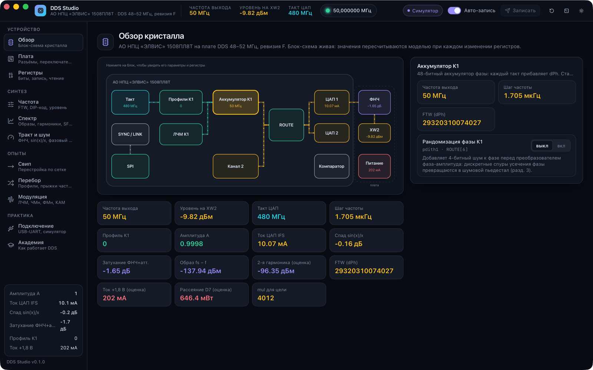
  <br><sub>Живая блок-схема 1508ПЛ8Т и выходного тракта платы: значения пересчитываются моделью при каждом изменении регистров.</sub>
</p>

## Скачать

| Платформа | Файл |
|---|---|
| macOS 11+ (Apple Silicon и Intel) | [`DDS-Studio-v0.1.0-macos-universal.dmg`](https://github.com/maximkurein/DDS/releases/latest) |
| Windows, веб | из исходников — [BUILD.md](BUILD.md) |

Со следующей версии настольное приложение — нативное, на egui; сборки называются `DDS-Studio-vX.Y.Z-macos-universal.dmg` и `DDS-Studio-vX.Y.Z-windows-x64.zip`.

Приложение не подписано сертификатом Apple: при первом запуске правый клик → «Открыть» или `xattr -dr com.apple.quarantine "/Applications/DDS Studio.app"`.

## Три сценария

| | Сценарий | Как |
|---|---|---|
| 🔌 | **Задать частоту с ПК** | «Подключение» → порт, 38400 → «Частота» → «Установить». Смена бесшовная, через профили 0/1. Подробно — [первый запуск](docs/FIRST_RUN_ru.md). |
| 📐 | **Рассчитать режим** | dPh, ошибка сетки, DIP-код, уровень на XW2, спектр с образами и гармониками, АЧХ фильтра, фазовый шум. |
| 🎓 | **Изучить DDS** | 11 уроков «Академии» и опыты: свип, перебор профилей, ЛЧМ, ЧМн/ФМн/АМн/КАМ-16. |

## Галерея

<table>
  <tr>
    <td width="50%">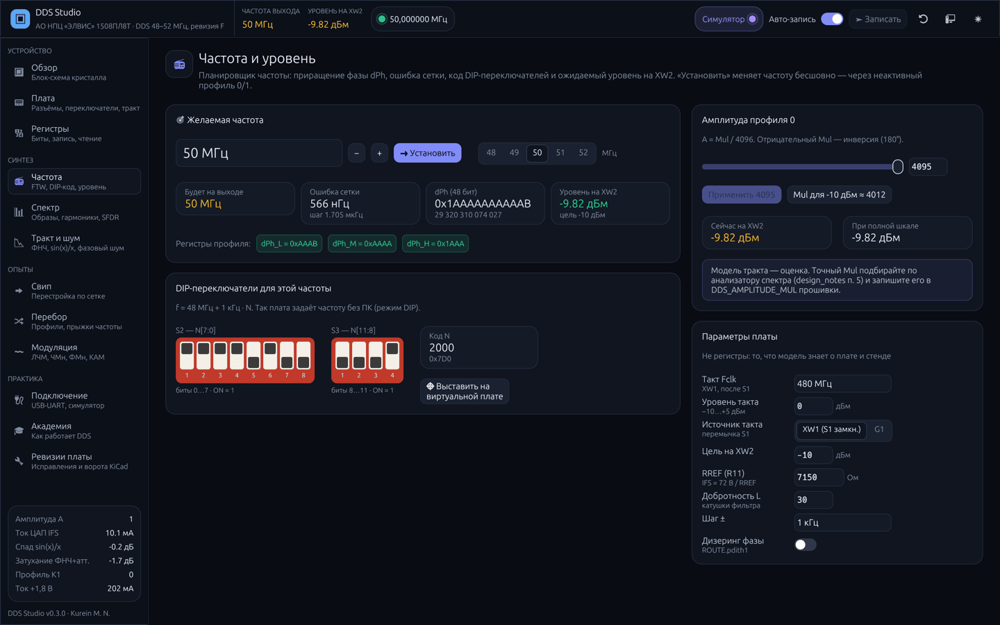<br><sub><b>Частота.</b> dPh, ошибка сетки, DIP-код, уровень на XW2, подбор Mul для −10 дБм.</sub></td>
    <td width="50%">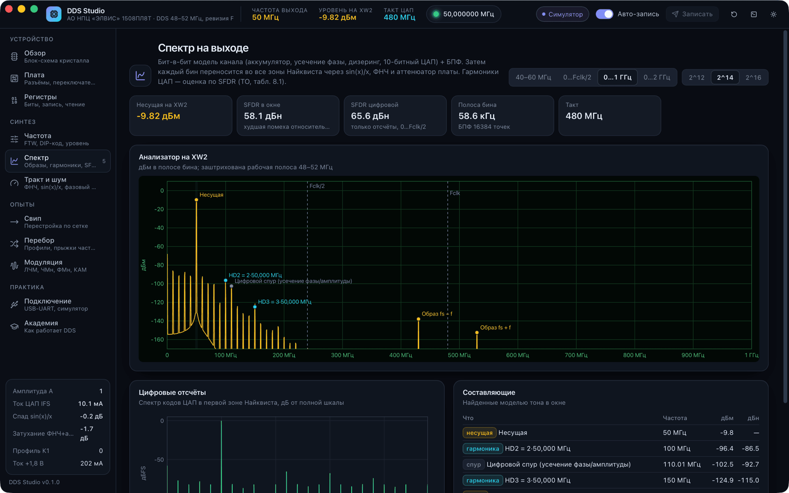<br><sub><b>Спектр.</b> Бит-в-бит модель канала: гармоники, образы, спуры усечения фазы, SFDR.</sub></td>
  </tr>
  <tr>
    <td>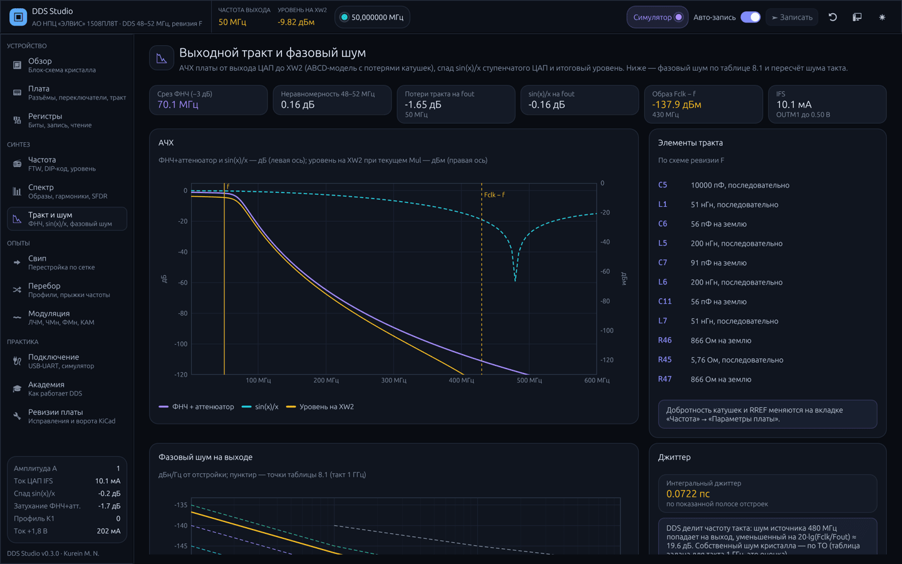<br><sub><b>Тракт и шум.</b> АЧХ ФНЧ и аттенюатора, sin(x)/x, фазовый шум и джиттер.</sub></td>
    <td>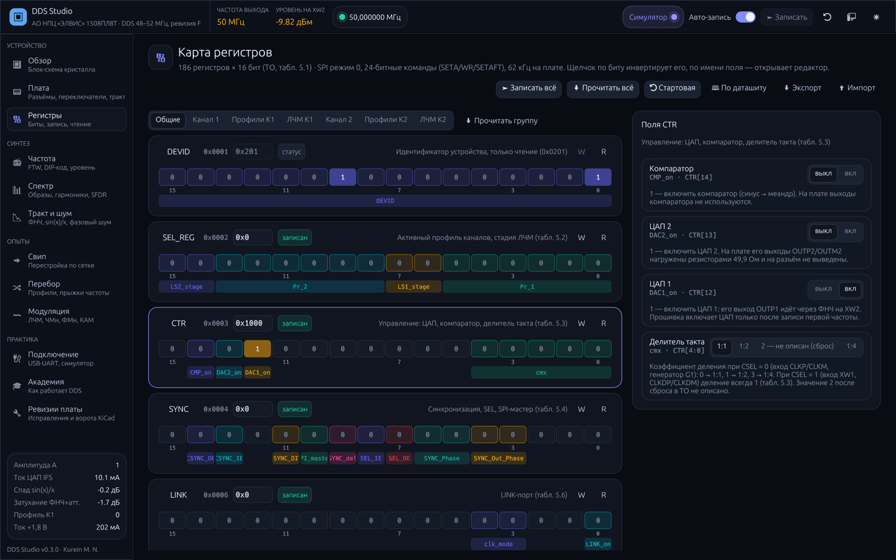<br><sub><b>Регистры.</b> Поля по битам, группы, запись и чтение, readback.</sub></td>
  </tr>
  <tr>
    <td>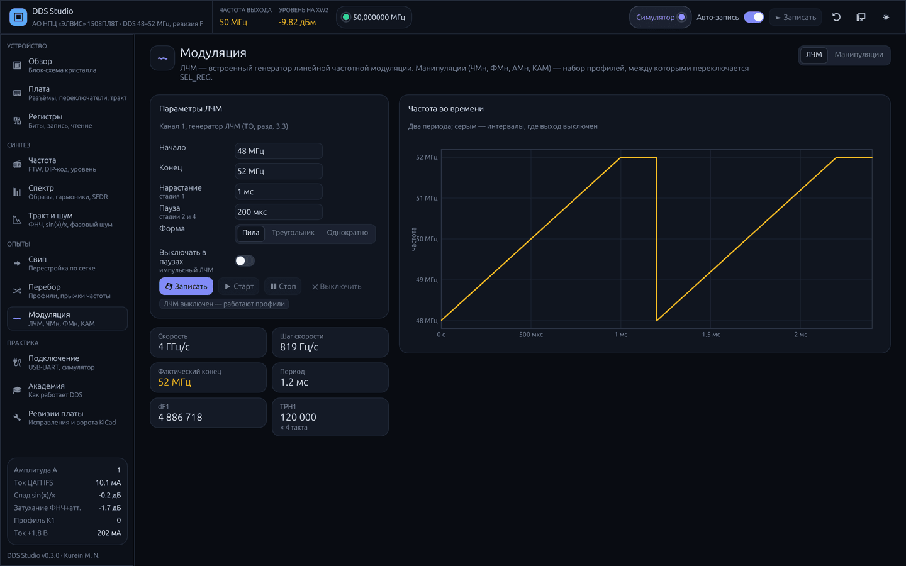<br><sub><b>ЛЧМ.</b> Пила, треугольник, однократно, импульсный режим.</sub></td>
    <td>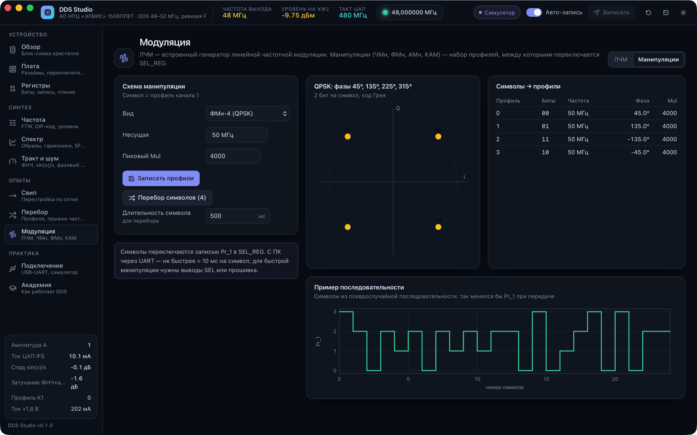<br><sub><b>Манипуляции.</b> ЧМн, ФМн, АМн, КАМ-16 на профилях, созвездие.</sub></td>
  </tr>
  <tr>
    <td>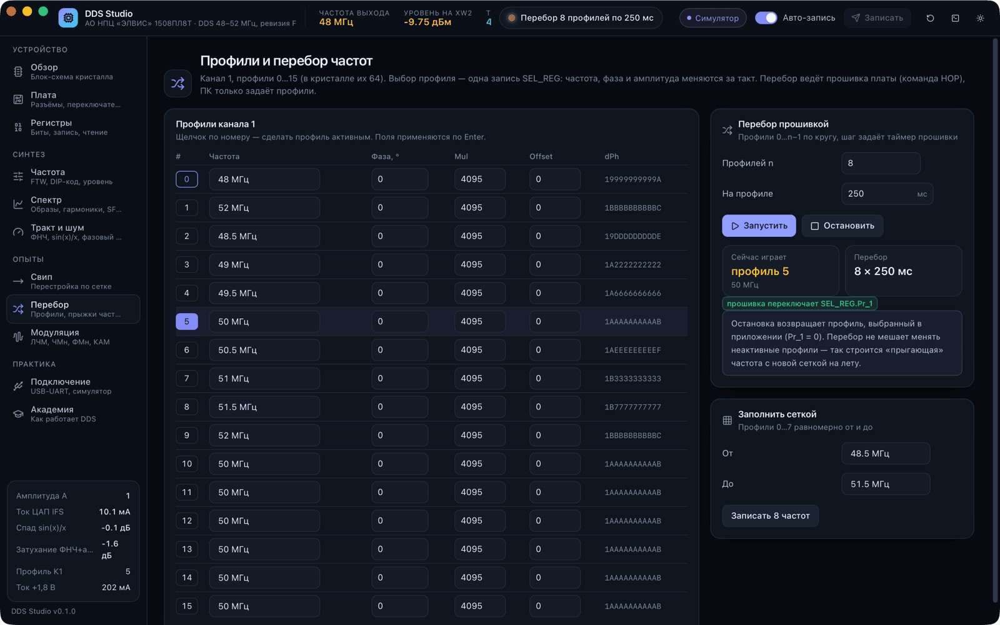<br><sub><b>Перебор.</b> Профили канала 1, перебор прошивкой по таймеру.</sub></td>
    <td>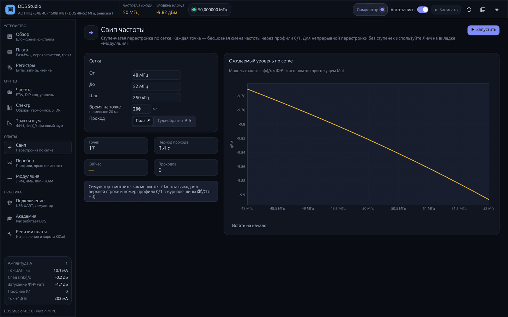<br><sub><b>Свип.</b> Ступенчатая перестройка по сетке.</sub></td>
  </tr>
  <tr>
    <td>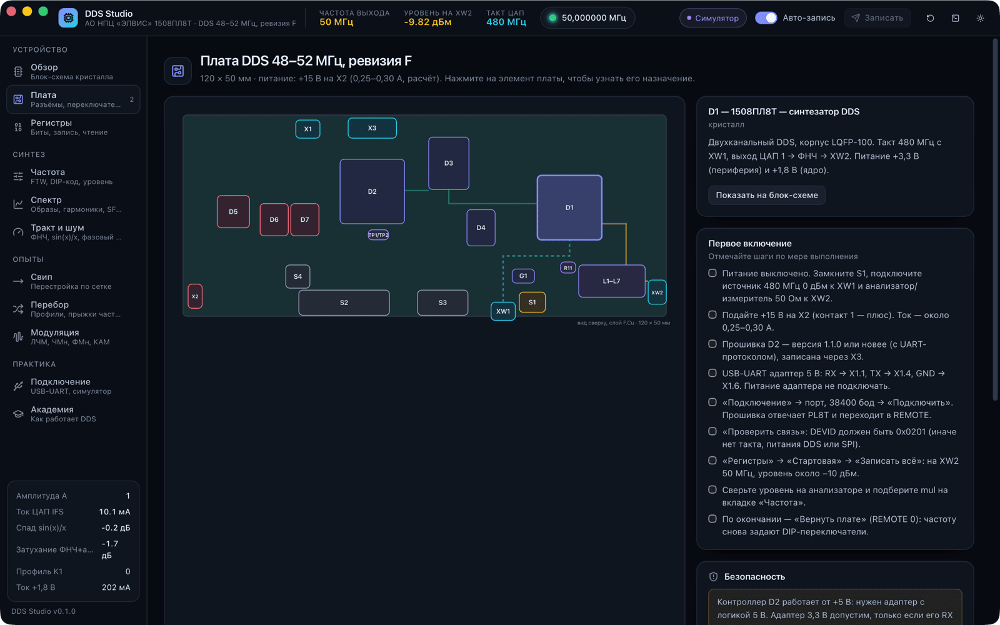<br><sub><b>Плата.</b> Элементы по файлу KiCad и чек-лист первого включения.</sub></td>
    <td>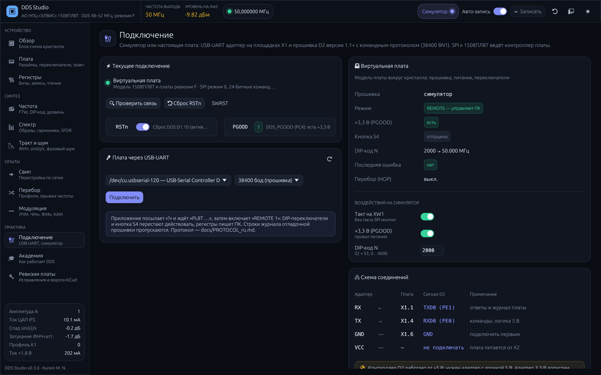<br><sub><b>Подключение.</b> USB-UART, состояние платы, воздействия на симулятор.</sub></td>
  </tr>
  <tr>
    <td>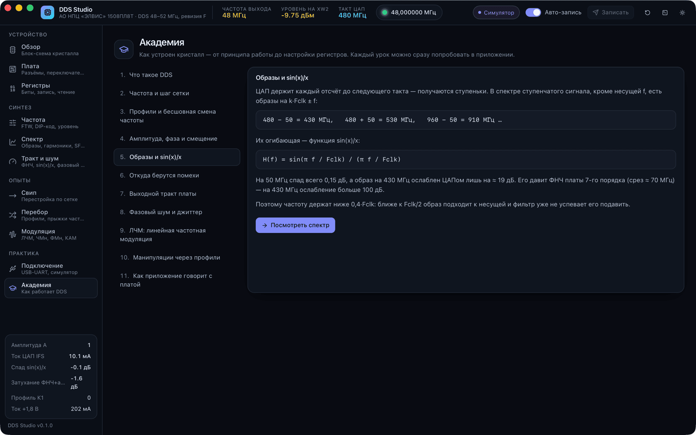<br><sub><b>Академия.</b> 11 уроков с переходом к опытам.</sub></td>
    <td>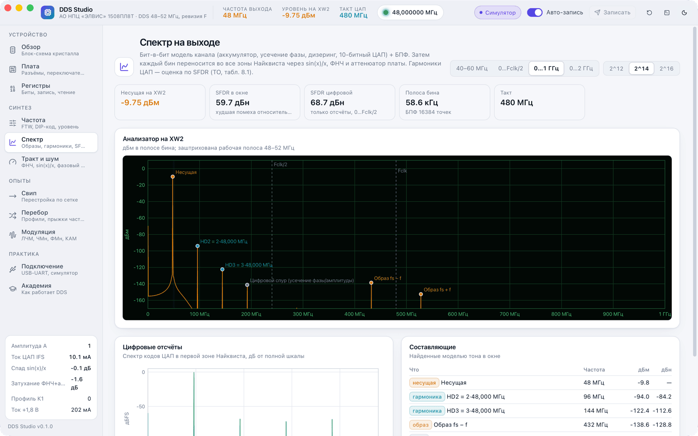<br><sub><b>Светлая тема.</b></sub></td>
  </tr>
</table>

## Как работает DDS

Каждый такт (480 МГц) 48-битный аккумулятор прибавляет приращение фазы dPh. Старшие 17 бит фазы превращаются в отсчёт синуса, он умножается на амплитуду Mul и попадает в 10-битный ЦАП. Ступеньки ЦАП сглаживает ФНЧ 7-го порядка на плате.

```
Fout = dPh · Fclk / 2⁴⁸          шаг сетки = 480 МГц / 2⁴⁸ ≈ 1,705 мкГц
50 МГц → dPh = 0x1AAA AAAA AAAB   ошибка 0,57 мкГц
```

В спектре, кроме несущей, есть образы k·Fclk ± f с огибающей sin(x)/x (на 430 МГц ЦАП ослабляет образ всего на ≈ 19 дБ, остальное делает фильтр), гармоники ЦАП и спуры усечения фазы. Всё это приложение считает бит-в-бит и показывает на экране «Спектр».

## Возможности

| Раздел | Что умеет |
|---|---|
| **Обзор** | Живая блок-схема 1508ПЛ8Т и выходного тракта платы, параметры и поля регистров каждого блока, предупреждения модели |
| **Плата** | Вид сверху по `DDS_48_52.kicad_pcb`: D1, D2, X1, XW1/XW2, S1–S4, ФНЧ; чек-лист первого включения; безопасность |
| **Регистры** | 186 регистров по ТО (табл. 5.1) по группам, редакторы полей, запись/чтение, сравнение readback, экспорт (текст и C-массив для прошивки) |
| **Частота** | Планировщик: dPh, ошибка, DIP-переключатели, уровень, подбор Mul для −10 дБм, параметры стенда |
| **Спектр** | Бит-в-бит модель канала + БПФ, перенос во все зоны Найквиста через sin(x)/x и фильтр; таблица составляющих, SFDR |
| **Тракт и шум** | АЧХ ФНЧ и аттенюатора (ABCD-модель с потерями катушек), sin(x)/x, фазовый шум и джиттер |
| **Свип** | Ступенчатая перестройка по сетке с заданным временем на точке |
| **Перебор** | 16 профилей канала 1, перебор прошивкой (`HOP`) с заданным периодом |
| **Модуляция** | ЛЧМ (пила, треугольник, однократно, импульсный), манипуляции 2/4-ЧМн, ФМн-2/4/8, 2/4-АМн, КАМ-16 с созвездием |
| **Подключение** | USB-UART, состояние платы (режим, PGOOD, DIP), воздействия на симулятор, схема проводов |
| **Академия** | Уроки от принципа DDS до протокола платы с переходом к опытам |
| **Журнал шины** | Каждый кадр SPI с расшифровкой изменённых полей (⌘/Ctrl + J) |

## Быстрый старт

```bash
cd studio
cargo run --release -p dds-egui     # настольное приложение (egui), или make app
```

Подробно о нативном интерфейсе — [EGUI.md](EGUI.md).

Веб-режим (удалённая лаборатория): `npm ci && npm run web` → http://127.0.0.1:7878.

| Клавиши | Действие |
|---|---|
| <kbd>⌘/Ctrl</kbd> + <kbd>1</kbd>…<kbd>9</kbd> | первые девять экранов |
| <kbd>⌘/Ctrl</kbd> + <kbd>J</kbd> | журнал шины |

## Подключение к плате

<p align="center">
  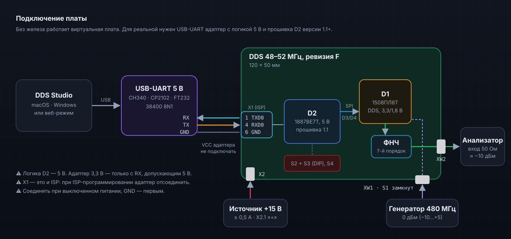
</p>

| Адаптер | Плата | Сигнал |
|---|---|---|
| RX | X1.1 | TXD0 (PE1) |
| TX | X1.4 | RXD0 (PE0) |
| GND | X1.6 | GND |

> [!WARNING]
> Контроллер D2 работает от **+5 В**: нужен адаптер с логикой 5 В (или 3,3 В, если его RX выдерживает 5 В). Питание адаптера к плате не подключать. X1 — это и площадки ISP: на время ISP-программирования адаптер отсоединить. Такт на XW1 — от −10 до +5 дБм; без такта SPI не работает. Подробно — [docs/PROTOCOL_ru.md](docs/PROTOCOL_ru.md).

Нужна прошивка D2 **1.1.0** или новее (`../firmware`): в ней командный протокол UART и режим REMOTE. После «Вернуть плате» (или сброса МК) частоту снова задают DIP-переключатели.

## Архитектура программы

<p align="center">
  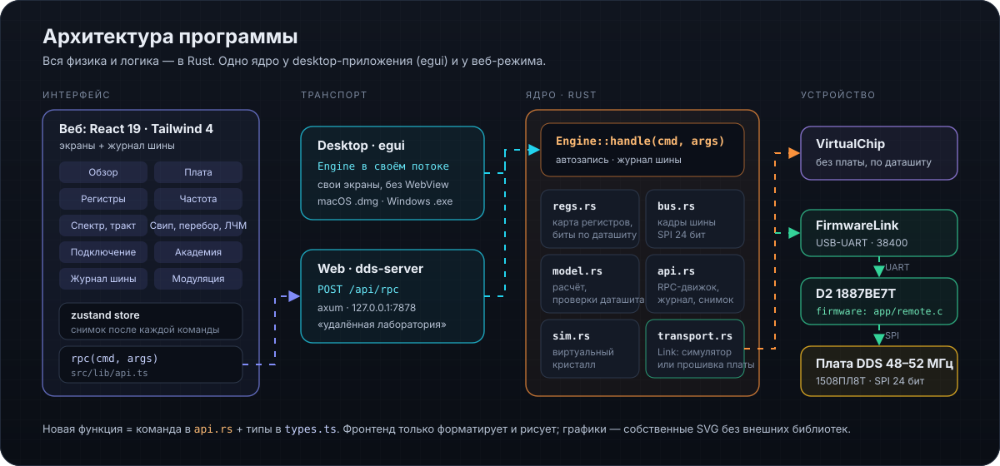
</p>

```
crates/dds-core     Rust: регистры, кадры SPI, модель, симулятор, транспорт, RPC-движок
crates/dds-server   HTTP-сервер (веб-режим): та же RPC + раздача интерфейса
crates/dds-egui     настольное приложение: нативный интерфейс на egui/eframe (EGUI.md)
src/                веб-интерфейс React 19 + Tailwind 4
../firmware/        прошивка контроллера D2 (команды UART — src/app/remote.c)
```

## Сборка и версии

| Платформа | Команда | Результат |
|---|---|---|
| macOS | `python3 build_macos.py [--universal]` | `.dmg` и `.app.zip` в `release/vX.Y.Z/` |
| Windows | `.\build_windows.ps1` | `.zip` с `DDS Studio.exe` в `release\vX.Y.Z\` |
| Веб | `make build-web` | `dist/` + `dds-server` |

Версия — только через `python3 tools/update_version.py` ([VERSION_MANAGEMENT.md](VERSION_MANAGEMENT.md)). Подробно о сборке — [BUILD.md](BUILD.md).

## Документация

- [Первый запуск с платой](docs/FIRST_RUN_ru.md)
- [Протокол платы (UART)](docs/PROTOCOL_ru.md)
- [Архитектура кода](docs/ARCHITECTURE_ru.md)
- [Выпуск релиза](docs/release_guide_ru.md)
- Первоисточник: [ТО 1508ПЛ8Т](https://elvees.ru/typo11/mc/data_sheets/Manual_1508PL8T.pdf) (АО НПЦ «ЭЛВИС», ред. 14.10.2020)

## Ограничения

- Модель — инженерное приближение по ТО и схеме платы: уровень на XW2 и Mul для −10 дБм уточняются измерением; гармоники ЦАП — оценка по SFDR табл. 8.1.
- В приложении редактируются профили 0…15 канала 1 и 0…3 канала 2 (в кристалле по 64).
- Прошивка 1.1.0 проверена unit-тестами на ПК; работа UART на плате ещё не проверена.
- Приложение не подписано сертификатом разработчика: macOS и Windows покажут предупреждение при первом запуске.

## Лицензия

[MIT](LICENSE)
