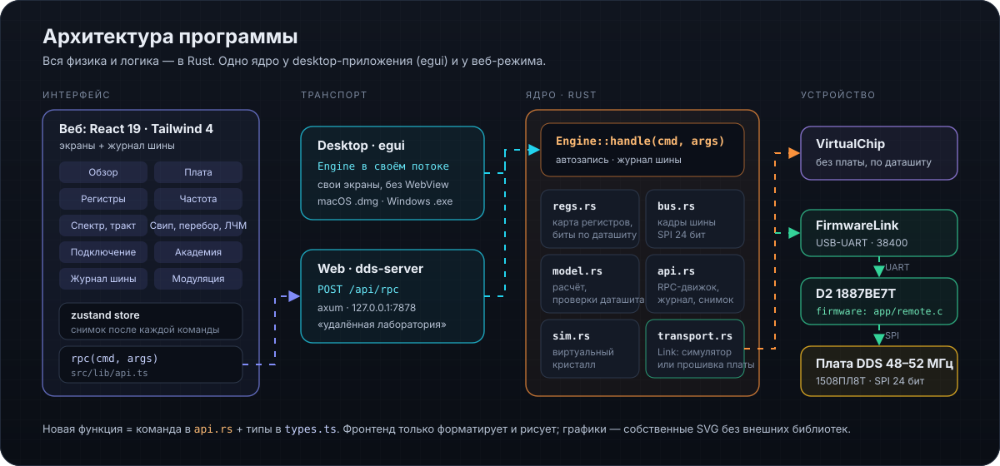

# Архитектура кода

<p align="center">
  
</p>

## Один RPC

Весь бэкенд — `Engine::handle(cmd, args) -> json` в `crates/dds-core/src/api.rs`. Desktop-оболочка вызывает его командой Tauri `rpc`, веб-сервер `dds-server` — через `POST /api/rpc`. Интерфейс вызывает `rpc()` из `src/lib/api.ts` и не знает, какой транспорт работает.

Новая функция = новая ветка `match cmd` в `api.rs` + типы в `src/lib/types.ts` + вызов `useStore().call()` (команды, меняющие состояние) или `useRpcData()` (расчёты).

## Путь команды до кристалла

```
интерфейс → rpc("set_frequency") → Engine → Link
   ├─ VirtualChip (симулятор): кадры SPI обрабатывает модель кристалла
   └─ FirmwareLink: строка «W 1410 AAAB» по USB-UART → прошивка D2 → SPI → 1508ПЛ8Т
```

Протокол прошивки — [PROTOCOL_ru.md](PROTOCOL_ru.md).

## Ядро (`crates/dds-core`)

| Модуль | Ответственность |
|---|---|
| `regs.rs` | карта регистров по ТО (табл. 5.1): общие регистры, по каналу — управление, ЛЧМ, профили (в приложении 16 профилей канала 1 и 4 канала 2, всего 186 регистров); поля с позициями битов, доступом, описаниями; `starter()` — рабочая конфигурация платы; порядок записи (CTR последним) |
| `bus.rs` | кадры SPI 24 бита: SETA, WR, WRI, SETAFT, NOP; расшифровка для журнала |
| `model.rs` | Fout = dPh·Fclk/2⁴⁸, sin(x)/x, ABCD-модель выходного тракта, уровень на XW2, план частоты и DIP-код, бит-в-бит модель канала и спектр, фазовый шум, расчёт ЛЧМ и манипуляций; предупреждения по ограничениям ТО |
| `sim.rs` | виртуальный кристалл и плата: сдвиговый регистр SPI, SWRST, CLR, LINK, стадии ЛЧМ, перебор профилей, PGOOD, такт, DIP |
| `transport.rs` | `Link`: симулятор или `FirmwareLink` (USB-UART, 38400); список портов, сканер USB |
| `api.rs` | движок: состояние, автозапись, журнал шины, бесшовная смена частоты, сохранение настроек |

## Прошивка платы (`../firmware`)

| Файл | Что |
|---|---|
| `src/app/app.c` | автомат: питание → сброс → настройка → работа; режим REMOTE |
| `src/app/remote.c` | выполнение команд UART |
| `src/core/cmdline.c` | разбор строк (тестируется на ПК) |
| `src/drivers/uart.c` | USART0: приём по прерыванию в кольцевой буфер |
| `src/drivers/pl8t.c` | драйвер 1508ПЛ8Т, `pl8t_frame()` для команды `S` |

## Интерфейс (`src`)

- `lib/store.ts` — состояние (zustand): снимок после каждой команды, опрос статуса раз в 350 мс (`board`, `live_profile`), журнал.
- `lib/useRpc.ts` — расчётные RPC с задержкой и ключом конфигурации.
- `components/fields.tsx` — редактор любого поля по метаданным из Rust.
- `lib/blocks.ts` — блоки схемы «Обзор» (`id` = `FieldDef.block`); `lib/board.ts` — плата (позиции из `DDS_48_52.kicad_pcb`), соединения, безопасность; `lib/lessons.ts` — уроки.
- `views/*View.tsx` — экраны: Обзор, Плата, Регистры, Частота, Спектр, Тракт и шум, Свип, Перебор, Модуляция, Подключение, Академия.

## Тесты

- `cargo test -p dds-core`: поля не перекрываются, адреса по ТО, кадры шины, FTW и уровни, спектр, ЛЧМ, манипуляции, симулятор (SPI, SWRST, LINK, перебор), протокол прошивки, экспорт/импорт.
- Прошивка: `cmake --preset host-tests && ctest --preset host-tests` — разбор команд и выполнение команд на настоящем коде `app.c`/`remote.c`/`pl8t.c` с подменой SPI.
