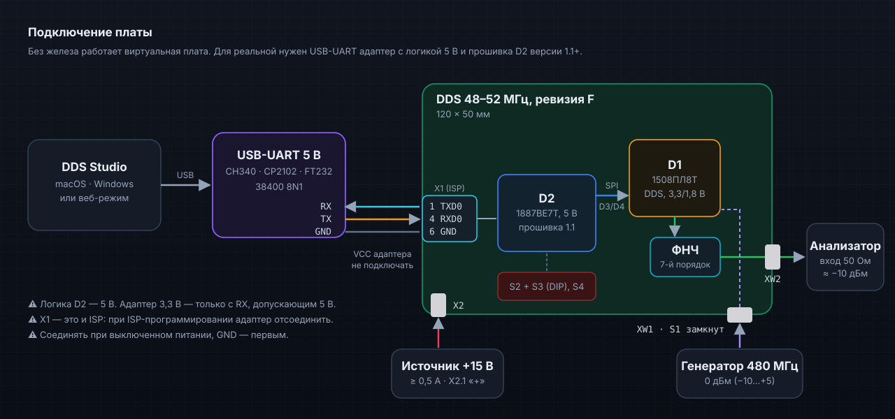

# Первый запуск с платой DDS 48–52 МГц, ревизия F

  

## 1. Без платы

Запустите приложение (`npm run app` или установщик из Releases). По умолчанию подключена **виртуальная плата**: модель 1508ПЛ8Т и прошивки D2. Все экраны работают, журнал шины (⌘/Ctrl + J) показывает кадры SPI, которые ушли бы в кристалл. На экране «Подключение» можно «выключить» такт или +3,3 В и посмотреть, как ведёт себя связь.

## 2. Что нужно

| Что | Зачем |
|---|---|
| Источник +15 В, ≥ 0,5 А | питание платы через X2 (контакт 1 — плюс); расчётный ток 0,25–0,30 А |
| Генератор 480 МГц, 0 дБм | такт DDS на XW1 (допустимо −10…+5 дБм, ТО табл. 8.1) |
| Анализатор спектра или измеритель мощности 50 Ом | выход XW2 |
| USB-UART адаптер с логикой 5 В | связь с контроллером D2 через площадки X1 |
| Прошивка D2 версии 1.1.0+ | командный протокол UART; записывается через JTAG (X3), см. `firmware/README.md` |

## 3. Подготовка платы

1. Питание выключено. Замкните **S1** (такт с XW1). Подключите генератор к XW1 и анализатор к XW2.
2. Подключите адаптер: **RX → X1.1**, **TX → X1.4**, **GND → X1.6**. Питание адаптера не подключайте.
3. Подайте +15 В. Прошивка запустит DDS и поставит частоту с DIP-переключателей (все OFF — 48 МГц).

## 4. Подключение приложения

1. «Подключение» → выберите порт адаптера (например, `/dev/cu.usbserial-…` или `COM5`), скорость **38400** → «Подключить».
2. Приложение отправит `?`, получит `PL8T 1.1.0…` и включит режим `REMOTE 1`. В карточке «Состояние платы» — «REMOTE — управляет ПК», PGOOD «есть», DIP-код.
3. «Проверить связь»: DEVID должен быть **0x0201**.
4. «Регистры» → «Стартовая» → «Записать всё». На XW2 — 50 МГц, около −10 дБм.
5. «Частота»: задайте частоту, нажмите «Установить» — смена бесшовная, через профили 0/1. Сверьте уровень с анализатором и при необходимости подберите Mul.
6. По окончании — «Вернуть плате» (`REMOTE 0`): частоту снова задают DIP-переключатели и кнопка S4.

## 5. Опыты

| Экран | Что попробовать |
|---|---|
| Спектр | несущая, гармоники, образ Fclk − f; включите/выключите дизеринг фазы |
| Тракт и шум | АЧХ фильтра, sin(x)/x, фазовый шум и джиттер |
| Свип | ступенчатая перестройка 48 → 52 МГц |
| Перебор | 8 частот в профилях 0…7 и перебор прошивкой (`HOP`) — видно на анализаторе |
| Модуляция | ЛЧМ 48 → 52 МГц за 1 мс; QPSK/КАМ-16 на профилях |

## Если что-то не так

| Симптом | Причина |
|---|---|
| «прошивка не ответила на ?» | прошивка без UART-протокола (старше 1.1), другая скорость, перепутаны RX/TX, нет общего GND |
| DEVID = 0x0000 | нет такта на XW1 (без такта SPI не работает), S1 разомкнут, нет +3,3/+1,8 В у DDS |
| `ERR POWER` | нет +3,3 В DDS: прошивка держит DDS в сбросе |
| `ERR STATE` | DDS перезапускается после провала питания — подождите и повторите «Записать всё» |
| `ERR LOCAL` | плата в режиме DIP (например, после сброса МК) — переподключитесь |
| уровень сильно отличается от −10 дБм | подберите Mul по анализатору, проверьте ФНЧ (L1–L7, C5–C11) и аттенюатор R45–R47 |
