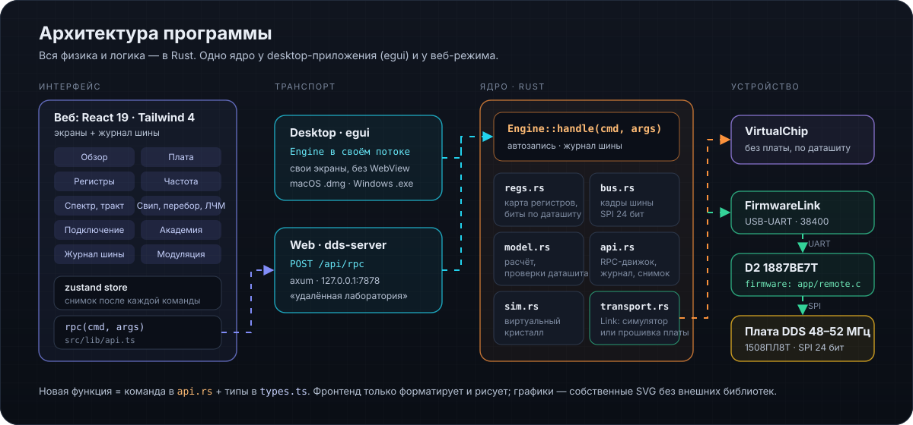

# Документация DDS Studio

  

| Руководство | О чём |
|---|---|
| [Первый запуск](FIRST_RUN_ru.md) | от подключения платы до первой записанной частоты |
| [Протокол платы](PROTOCOL_ru.md) | USB-UART, команды прошивки D2, режим REMOTE |
| [Архитектура](ARCHITECTURE_ru.md) | как устроен код: ядро Rust, RPC, прошивка, интерфейс |
| [Выпуск релиза](release_guide_ru.md) | версия, тег, сборка, публикация |
| [Сборка](../BUILD.md) | macOS, Windows, веб |
| [Версии](../VERSION_MANAGEMENT.md) | единый источник версии и чек-лист |

## Первоисточники

- ТО 1508ПЛ8Т, АО НПЦ «ЭЛВИС», ред. 14.10.2020: <https://elvees.ru/typo11/mc/data_sheets/Manual_1508PL8T.pdf>
- Схема и плата: `../../DDS_48_52.kicad_sch`, `../../DDS_48_52.kicad_pcb` (ревизия F)
- Прошивка D2: [`../../firmware/README.md`](../../firmware/README.md), руководство пользователя: [`../../USER_GUIDE.md`](../../USER_GUIDE.md)

PDF производителя в репозиторий не кладём — только ссылки.

## Что не подтверждено

- Модель уровня на XW2 — расчёт по схеме (добротность катушек, допуски); Mul для −10 дБм уточняется измерением.
- Гармоники ЦАП — оценка по SFDR из табл. 8.1, а не модель нелинейности.
- Фазовый шум кристалла по табл. 8.1 задан для такта 1 ГГц; для 480 МГц это оценка.
- Прошивка 1.1.0 проверена unit-тестами на ПК с подменой SPI; сборка avr-gcc и работа UART на плате ещё не проверялись.
