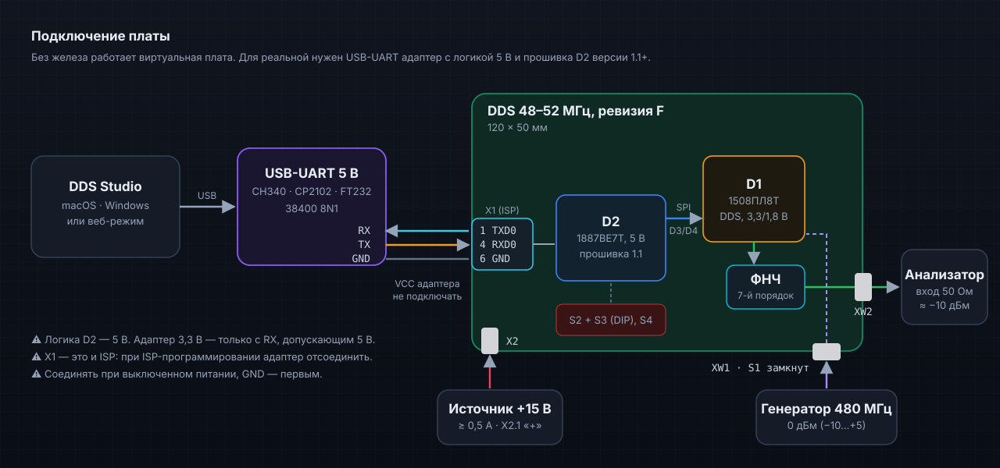

# Протокол связи с платой (UART, прошивка D2 1.1+)

<p align="center">
  
</p>

DDS Studio не управляет SPI напрямую: шиной 1508ПЛ8Т владеет контроллер платы D2 (1887ВЕ7Т). Начиная с прошивки **1.1.0** он принимает текстовые команды по USART0 и выполняет их на SPI. Исходники: `firmware/src/core/cmdline.c` (разбор), `firmware/src/app/remote.c` (выполнение), `firmware/src/drivers/uart.c` (USART0).

> [!WARNING]
> Контроллер D2 работает от **+5 В**. Нужен USB-UART адаптер с логикой 5 В. Адаптер 3,3 В подойдёт, только если его RX выдерживает 5 В; уровень 3,3 В на X1.4 — на границе VIH = 0,6·VCC = 3 В. Питание адаптера к плате **не подключать**. X1 — это и площадки ISP: на время ISP-программирования адаптер отсоединить.

## Подключение

| Адаптер | Плата | Сигнал D2 | Примечание |
|---|---|---|---|
| RX | X1.1 | TXD0 (PE1, ISP_PDO) | ответы и журнал |
| TX | X1.4 | RXD0 (PE0, ISP_PDI) | команды |
| GND | X1.6 | GND | подключать первым |
| VCC | — | — | не подключать: плата питается от +15 В через X2 |

Параметры порта: **38400 8N1**, без управления потоком. При RC 8 МГц и U2X: UBRR = 25, ошибка 0,2 %. Точность скорости зависит от калибровки OSCCAL (см. `firmware/README.md`).

## Формат

- Одна команда в строке, конец строки — `\r` или `\n`. Регистр букв не важен. Длина строки до 32 символов (иначе `ERR LONG`).
- Адреса и данные — шестнадцатеричные без префикса; `REMOTE`, `PIN`, `HOP` — десятичные.
- Ответ — одна строка, заканчивается `\r\n`. Ответами считаются только строки, начинающиеся с `OK`, `ERR` или `PL8T`. Всё остальное (журнал отладочной сборки, загрузочный баннер) приложение пропускает.

## Команды

| Команда | Ответ | Что делает |
|---|---|---|
| `?` | `PL8T 1.1.0+<git> DDS48-52 uart1` | опознание |
| `REMOTE 1` | `OK` | управление переходит к ПК: DIP, кнопка S4 и проверка CTR отключаются |
| `REMOTE 0` | `OK` | вернуть плату переключателям: перезапуск DDS и частота с DIP |
| `W aaaa dddd` | `OK` | запись регистра: кадры `10 aaaa`, `20 dddd` (SETA + WR) |
| `R aaaa` | `OK dddd` | чтение: `B0 aaaa` (SETAFT), `00 0000` (NOP), данные — из второго кадра |
| `S xxxxxx` | `OK 00yyyy` | один 24-битный кадр SPI как есть; `yyyy` — 16 бит, сдвинутые из кристалла |
| `RST` | `OK` | импульс RSTn (`DDS_RESET_PULSE_MS`), затем пауза восстановления |
| `PIN RSTn 0` / `PIN RSTn 1` | `OK` | держать DDS в сбросе / отпустить |
| `HOP n ms` | `OK` | прошивка перебирает профили 0…n−1 канала 1 с периодом `ms` (n = 2…64, ms = 1…60000) |
| `HOP 0` | `OK` | остановить перебор |
| `ST` | `OK pgood=1 apply=0 dip=2000 remote=1 err=0 hop=0 ms=0` | состояние платы |

`ST` и `?` работают в любом режиме. Остальные команды, обращающиеся к DDS, — только после `REMOTE 1`.

### Поля `ST`

| Поле | Значение |
|---|---|
| `pgood` | 1 — есть +3,3 В DDS (DDS_PGOOD, PC4) |
| `apply` | 1 — нажата кнопка S4 |
| `dip` | код N с переключателей S2 (биты 0…7) и S3 (биты 8…11), ON = 1 |
| `remote` | 1 — режим REMOTE |
| `err` | код последней ошибки драйвера: 0 — нет, 1 — SPI, 2 — DEVID, 3 — VERIFY, 4 — POWER |
| `hop`, `ms` | перебор профилей: число и период (0 — выключен) |

## Ошибки

| Ответ | Причина | Что делать |
|---|---|---|
| `ERR LOCAL` | команда требует режима REMOTE | отправить `REMOTE 1` (приложение делает это при подключении) |
| `ERR POWER` | нет +3,3 В: DDS в сбросе, буфер D3 выключен | проверить питание платы |
| `ERR STATE` | DDS запускается после сброса или провала питания | повторить через 0,1–0,5 с |
| `ERR SPI` | модуль SPI не завершил обмен | проверить прошивку и такт МК |
| `ERR ARG` | неверные аргументы | — |
| `ERR CMD` | неизвестная команда | — |
| `ERR LONG` | строка длиннее 32 символов или переполнение приёмного буфера | — |

## Режим REMOTE

- После включения прошивка работает как раньше: ждёт питание, настраивает DDS и ставит частоту с DIP.
- `REMOTE 1` ничего не перезаписывает. Текущая настройка остаётся, дальше её меняет ПК.
- В REMOTE прошивка не трогает DDS сама. Контроль PGOOD остаётся: при провале питания DDS уходит в сброс. После возврата питания следует импульс RSTn и состояние RUN, но **без** инициализации — регистры в сбросовом состоянии, их записывает ПК (в приложении — «Записать всё»).
- Сброс МК всегда возвращает режим DIP.
- Сборка прошивки без команд: `-DDDS_REMOTE=OFF`.

## Бесшовная смена частоты

Приложение делает то же, что прошивка в режиме DIP:

1. пишет новое приращение фазы в **неактивный** профиль (0 или 1): `W 1410 …`, `W 1411 …`, `W 1412 …`;
2. включает его записью `SEL_REG` (`W 0002 0001`).

Частота меняется за один такт, без промежуточных значений и разрыва фазы (ТО, разд. 3.2).

## Проверка вручную

```bash
screen /dev/cu.usbserial-XXXX 38400
```

Наберите `?`, затем `REMOTE 1`, `R 0001` — ответ должен быть `OK 0201` (DEVID). `REMOTE 0` вернёт плату переключателям.

## Ссылки

- ТО 1508ПЛ8Т (ред. 14.10.2020): <https://elvees.ru/typo11/mc/data_sheets/Manual_1508PL8T.pdf> — разд. 3.2 (профили), 5 (регистры), 9 (SPI: кадры 24 бита).
- Прошивка D2: [`../../firmware/README.md`](../../firmware/README.md), раздел 8.5.
